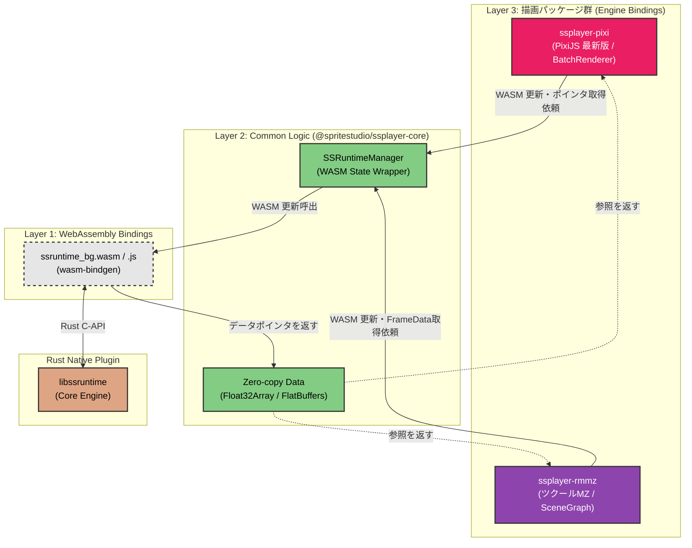

# SpriteStudio7-SDK Player for Web アーキテクチャ設計書

本ドキュメントは、SpriteStudio7-SDK の Web 向けプレイヤー機能（SSPlayerForWeb）に関する、技術的アプローチとアーキテクチャの全容を定義した設計書です。
PixiJS の最新版から、RPGツクールMZ（PixiJS v5）などのレガシー環境、さらには Three.js などの全く異なるグラフィックエンジンまで、**あらゆる環境へ展開可能な「マルチパッケージ構成（パッケージ分離戦略）」** を大前提としています。

## 1. コア設計思想 (Core Philosophy)

> [!TIP]
> **「あらゆる Web 描画環境への適応」 と 「WebAssembly (Rust) による限界性能」 の両立。**

- **マルチエンジン対応 (パッケージの完全分離戦略)**
  - NPMの依存関係（`peerDependencies`）の衝突を防ぐため、1つの巨大なプレイヤーを作るのではなく、**「ロジック計算を行う純粋なコアパッケージ」と「各環境に特化した複数の描画パッケージ」を完全に分離・独立させるアーキテクチャ**を採用します。
- **ハイブリッド構成 (WASM Brain + JS Body)**
  - 内部の補間・行列計算ロジックは WebAssembly (Rust) 側で一括処理し、JS 側での不要なオブジェクト生成（ガベージコレクションの発生）をゼロに抑えます。
- **環境に最適化されたレンダリング手法の選択**
  - 環境が許す限りは最速の**「ダイレクト描画（バッチレンダリング）」**を用いますが、古いエンジン環境向けには**「シーングラフ描画」**を選択できる柔軟性を持ち合わせます。

## 2. パッケージ構成と責任分界点 (Monorepo)

マルチパッケージ展開を前提とした Monorepo 構成において、以下のnpmパッケージ群を構築します。

### A. `@spritestudio/ssplayer-core` (エンジン非依存コア)
- WASM の初期化、時間更新、`RenderMode`の管理、WASM メモリからのデータ抽出を担当。
- **鉄則**: DOM API や特定の描画エンジンへの依存を一切持たない純粋なロジック層とします。
- 生データのパース (`FrameData` の FlatBuffers リーダー等) もこのパッケージが提供します。

### B. 描画パッケージ群 (環境特化ガワ)
`core` と対象エンジンに依存し、各エンジンに最適な描画コンポーネントやアセットローダーを提供します。
- **`@spritestudio/ssplayer-pixi` (PixiJS 最新版向け: v8ダイレクト描画)**
  - 対象: PixiJS v8。
  - 設計方針: v8の低レベルAPI (`MeshGeometry`, `Batcher`, `BLEND_MODES`) が ssruntime の出力構造と非常に相性が良いため、ダイレクト描画で極限のパフォーマンスを引き出します。
  - 実装フローとマッピング:
    - WASM を `RenderMode::Direct` に設定して `DrawBatch` の恩恵をフルに受けます。
    - `local_vertices` (頂点 SoA) は `MeshGeometry.positionBuffer` に、`local_uvs` (UV SoA) は `MeshGeometry.uvBuffer` にゼロコピーで流し込みます。
    - 毎フレーム `DrawBatch` をループし、バッチごとに 1 ドローコールを発行して描画します。マスクは `DrawBatchKind::Mask` をフックに `StencilMask` / `MaskFilter` で対応します。
    - （※既存の ss6player と異なり、SS7専用の新規パッケージとします）
- **`@spritestudio/ssplayer-rmmz` (ツクールMZ向け: v5シーングラフ描画)**
  - 対象: RPGツクールMZ (PixiJS v5 固定環境)。実装の優先度は `ssplayer-pixi` より後回し（需要を見て判断）。
  - 設計方針: 
    - MZ は Pixi v5 からバージョンを上げられず、またシーン構造全体が `PIXI.Sprite` の階層に強く依存しています（キャラへの追従など）。
    - ツクール特有の「プラグイン1ファイル配布文化」があるため、WASMの別途ロードといった複雑な構成はユーザーを詰まらせる原因になります。
  - 手法:
    - WASM を `RenderMode::SceneGraph` に設定し、`DrawBatch` によるバッチ最適化の旨味は完全に捨て、「WASMをただのボーン・アニメーション計算機として使う」という割り切ったアプローチを取ります。
    - 計算済みの `world_matrices` などを SoA バッファから読み、パーツ数分構築した `PIXI.Sprite` ツリーの `position`/`rotation`/`scale`/`tint` に流し込むだけに留めます。
- **(将来用) `@spritestudio/ssplayer-three`** (Three.js 向け等)

### アセットと座標系の分界点
- **座標系の設定**: エンジンごとに座標系（Y-Up/Y-Down）が異なるため、`core` が提供する `ss_context_set_coordinate_system` などの API を用い、各パッケージが自エンジンに合わせて設定します。例えば Pixi 系では「Y-Down + Top-Left」を指定することで、Player側での座標変換計算を不要にし、ランタイム側に吸収させます。
- **メタデータのパース**: `ssruntime` 自体はパーツ名や親子関係、テクスチャパス等のメタデータを返さない仕様のため、これらは Player 側で `.ssab` を FlatBuffers リーダーを使って別途パースして解決します。
- **テクスチャロード**: `core` は必要となるテクスチャのハッシュを返すのみとし、実際の画像ファイルの `fetch` と GPU への転送は各描画パッケージの仕組み (`PIXI.Assets` 等) に一任します。

## 3. 3層のレイヤーアーキテクチャ (Layer Architecture)



## 4. WebAssembly 特有の堅牢化設計 (Robustness)

ブラウザ上で WASM を安定動作させるため、以下の安全機構を `ssplayer-core` に標準搭載します。

### A. メモリリーク防止機構 (FinalizationRegistry)
WASM 側のメモリ領域は JS の GC（ガベージコレクション）対象外です。
ユーザーが明示的に `destroy()` を呼び忘れた際のクラッシュを防ぐため、JS の最新APIである **`FinalizationRegistry`** を使用し、安全網として WASM の `free()` を自動実行するバックアップ機構を設けます。

### B. JS と WASM 間のデータ二重持ち回避 (Zero-Duplication)
ネットワークから `fetch` した `.ssab` バイナリを WASM (Rust) に渡して初期化する際、メモリの二重持ちを防ぐ必要があります。
- **生データの即時 GC**: JS 側でダウンロードした生データ (`Uint8Array`) は、WASM 側に渡した直後に JS 側の参照を破棄し GC に回収させます。
- **WASM メモリの逆参照 (Borrow)**: JS 側からメタデータが必要な場合は、WASM 側のゲッター API を経由するか、Rust 側から返されたポインタを元に `new Uint8Array(wasmMemory.buffer, ptr, len)` として WASM 側のメモリを直接覗き込む（Borrow する）設計とし、メモリの二重確保を完全に防ぎます。

### C. MIME タイプトラップへのフォールバック
サーバーの設定不備で WASM が `application/octet-stream` で返されると最速ロード (`instantiateStreaming`) が失敗します。
このエラーを検知し、自動的に通常の `ArrayBuffer` としてロードし直すフォールバック処理を実装します。

## 5. アセットパイプライン設計 (Loader)

各描画パッケージ（例: `ssplayer-pixi`）は、対象エンジンに最適化されたアセットローダーを提供します。

- **SSABLoader (例: PIXI.Assets カスタム拡張)**:
  `PIXI.Assets.load('character.ssab')` が呼ばれた際に、内部でバイナリを取得し、WASM 用の `SSRuntimeResource` インスタンスへパースしてキャッシュに登録します。
- **リソース共有の保証**:
  複数体のキャラクターを画面に出す場合でも、キャッシュされた単一の `SSRuntimeResource` インスタンスが使い回されるため、WASM 側のメモリの重複を完全に防ぎます。

## 6. プロジェクト構成と開発ワークフロー

```text
SSPlayerForWeb/ (新規リポジトリ)
├── SpriteStudio7-SDK/            <- [Git Submodule] Rustのコア実装
│
├── packages/
│   ├── ssplayer-core/            <- [コア] WASM初期化・計算ロジック
│   ├── ssplayer-pixi/            <- [PixiJS最新版向け] ダイレクト描画
│   └── ssplayer-rmmz/            <- [ツクールMZ向け] シーングラフ描画
│
├── examples/                     <- 開発・動作検証用のアプリ群
│   ├── pixi-example/             <- Vite + PixiJS のテスト環境
│   └── rmmz-example/             <- Vite + ツクールMZ互換 のテスト環境
│
├── package.json                  <- pnpm workspace 定義
└── scripts/                      <- WASMビルド自動化スクリプト
```

## 7. コールドスタートのための実装ガイド (Implementation Guide)

本設計書のみで迷いなく実装を開始できるよう、WASM バインディングの具体的な境界とゼロコピーのコードパターンを定義します。

### A. WASM ビルドと FFI 境界 (build-runtime)
Rust 側のコアロジックを Web 向けにコンパイルして配置する処理は、プラットフォームごとに自動化スクリプト（`scripts/build-runtime.sh` および `.ps1`）として用意します。

**`scripts/build-runtime.sh` (Mac/Linux用)**
```bash
#!/bin/bash
set -e
echo "Building WASM runtime..."
wasm-pack build SpriteStudio7-SDK/libs/ssruntime --target web --out-dir ../../packages/ssplayer-core/wasm
echo "WASM build complete!"
```

これにより生成される JS/WASM バインディングは、主に `SSRuntimeResource` と `SSRuntimeContext` を JS 側に露出します。`ssplayer-core` はこれらをさらにラップして管理します。

### B. ゼロコピーアクセス (Float32Array) の具象コード
WASM 側の計算結果を JS 側に渡す際は、アロケーションをゼロにするため `memory` オブジェクトを利用して以下のように View を張ります。

```typescript
// 毎フレームの更新とポインタの取得 (ダイレクト描画の例)
public updateAndGetMatrices(deltaSeconds: number): Float32Array {
    this.context.update(deltaSeconds);
    const ptr = this.context.get_world_matrices_ptr();
    const count = this.context.get_parts_count();
    
    // JS 側の Float32Array ビューとしてメモリを「参照」する (コピーは発生しない)
    return new Float32Array(wasmMemory.buffer, ptr, count * 16);
}
```
この配列を `ssplayer-pixi` 等のパッケージが受け取り、各エンジンのバッファ更新 API へ流し込みます。
