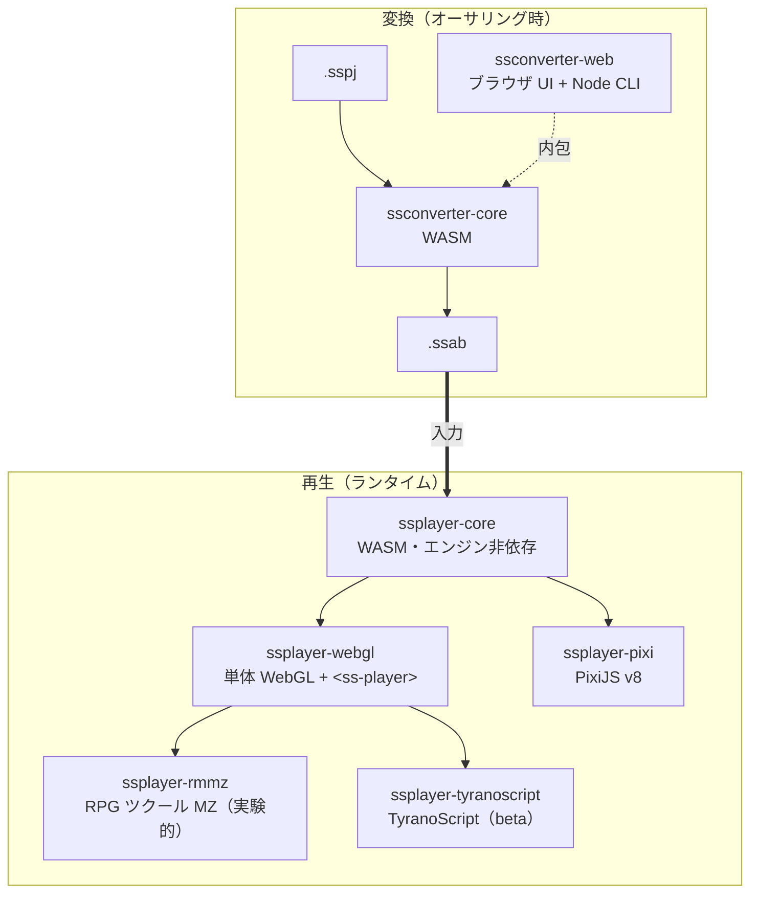

[**English**](./README.md) | [**日本語**](./README.ja.md)

# SSPlayerForWeb

**Web のためのプロ品質 2D アニメーション。WebAssembly 製の単一コアを、モダンな PixiJS や依存ゼロの単体 WebGL エンジンで描画する。**

**[OPTPiX SpriteStudio 7](https://www.webtech.co.jp/spritestudio/)** で制作したアニメーション (`.ssab`) を Web ブラウザ上で再生する高性能プレイヤーです。すでにお持ちのスプライト素材 (PNG / WebP) を専用エディタでアニメーションさせ、動画ファイルも作り直しも不要で、お好みのレンダリングエンジンからブラウザで再生できます。

## 🌐 ブラウザで試す

インストール不要、すべてブラウザ上で動作します（🚧 初回リリースの公開後に有効になります）:

- 🛠️ **[ssconverter-web](https://cri-middleware.github.io/SSPlayerForWeb/ssconverter/)** — `.sspj` → `.ssab` をブラウザ内で変換（まずはここから）
- ▶️ **[単体 WebGL サンプル](https://cri-middleware.github.io/SSPlayerForWeb/examples/webgl/)** — 依存ゼロの単体レンダラー（`<ss-player>` Web コンポーネント）。※`.ssab` のD&D再生に対応
- ▶️ **[PixiJS サンプル](https://cri-middleware.github.io/SSPlayerForWeb/examples/pixi/)** — PixiJS v8 アプリ向け。※`.ssab` のD&D再生に対応
- ▶️ **[RPG ツクール MZ サンプル](https://cri-middleware.github.io/SSPlayerForWeb/examples/rmmz/)** — サンプル MZ プロジェクト（SpriteStudio ピクチャ）
- ▶️ **[TyranoScript サンプル](https://cri-middleware.github.io/SSPlayerForWeb/examples/tyrano/)** — `[ss_*]` タグで動かすヴィジュアルノベルのシーン（beta）

## 📚 ドキュメント

詳細なドキュメントは `docs/` フォルダ内で提供しています（VitePress にてホスティング）。読者の目的に応じて段階的に読み進められる構成です。

- [**ドキュメントサイト (ホスト版)**](https://cri-middleware.github.io/SSPlayerForWeb/) — 🚧 初回リリース後に公開
- [**日本語ドキュメント**](./docs/ja/index.md) · [**English docs**](./docs/index.md)

### クイックリンク (日本語)
- [インストール](./docs/ja/setup/install.md)
- [クイックスタート](./docs/ja/setup/quickstart.md)
- [基本的な使い方](./docs/ja/usage/basic.md)
- [アセットの準備](./docs/ja/usage/assets.md)
- [WebGL・Web Components で使う](./docs/ja/usage/webgl.md)
- [PixiJS で使う](./docs/ja/usage/pixi.md)
- [SS6Player for Web からの移行](./docs/ja/migration_from_ss6.md)

### 目的別・どこから読むか
目的の達成に必要な範囲だけを読んで利用できます。

| あなたは… | ゴール | 読むところ |
|---|---|---|
| **利用ユーザー** | とにかくアニメーションを動かしたい | [クイックスタート](./docs/ja/setup/quickstart.md) → [基本的な再生](./docs/ja/usage/basic.md) |
| **カスタマイズユーザー** | 表現を作り込み、ロジックを追加したい | 上記 + [カスタマイズ](./docs/ja/customize/events.md) |
| **SDK / Player 開発者** | 内部の拡張やコアに貢献したい | 上記 + [CONTRIBUTING.md](./CONTRIBUTING.md) |

## 🎯 どのパッケージを使うか

各レンダラーは WASM コアを同梱しているので、インストールするのは1つだけ — 環境に合う行を選んでください。**そのスタック（PixiJS / 素の WebGL …）で SpriteStudio を選ぶ理由**は各パッケージの README に記載しています。

| あなたの環境 | パッケージ | 実行できるサンプル |
|---|---|---|
| **単体 / フレームワーク非依存**（`<ss-player>` Web Component） | [`@spritestudio/ssplayer-webgl`](./packages/ssplayer-webgl) | [examples/webgl-example](./examples/webgl-example) |
| **PixiJS v8 アプリ** | [`@spritestudio/ssplayer-pixi`](./packages/ssplayer-pixi) | [examples/pixi-example](./examples/pixi-example) |
| **自作レンダラーを実装する** | [`@spritestudio/ssplayer-core`](./packages/ssplayer-core) | — |
| **`.sspj` → `.ssab` を変換する** | [`ssconverter-web`](./packages/ssconverter-web)（Web ツール + Node CLI） | — |
| **変換機能を自作アプリ/サービスに組み込む** | [`@spritestudio/ssconverter-core`](./packages/ssconverter-core) | — |

**ゲームエンジン統合** — `ssplayer-webgl` の上に載る薄いアダプターです。いずれも **実験的**（`alpha`、npm 未公開）です:

| あなたの環境 | パッケージ | 実行できるサンプル |
|---|---|---|
| **RPG ツクール MZ**（PixiJS v5） | [`@spritestudio/ssplayer-rmmz`](./packages/ssplayer-rmmz) | [examples/rmmz-example](./examples/rmmz-example) |
| **TyranoScript / TyranoBuilder**（ノベル） | [`@spritestudio/ssplayer-tyranoscript`](./packages/ssplayer-tyranoscript) | [examples/tyranoscript-example](./examples/tyranoscript-example) |

## 🚀 クイックスタート

入口は2つあります。自分に合うほうを選んでください:

- **A. このリポジトリでサンプルを動かす** — SSPlayerForWeb を評価する、またはローカルで開発する人向け。
- **B. 自分のプロジェクトで使う** — 制作中のアプリにパッケージを導入する人向け。

### A. このリポジトリでサンプルを動かす

**前提条件:** [Node.js](https://nodejs.org/) と [pnpm](https://pnpm.io/)（本リポジトリは pnpm workspaces を使用します）。以下の手順は **プリビルド** の WASM コアを取得するため、Rust ツールチェーンは不要です。

```bash
git clone https://github.com/cri-middleware/SSPlayerForWeb.git
cd SSPlayerForWeb
git submodule update --init --recursive  # SpriteStudio-SDK（サンプル素材＋コア）を取得
pnpm install                             # 依存関係のインストール & ワークスペースの初期化
pnpm run download:wasm                   # プリビルド WASM を取得（macOS・Windows 共通）
pnpm run build                           # すべての TypeScript パッケージをビルド
pnpm run deploy-examples                 # examples が読み込む .ssab アセットを生成
cd examples/webgl-example
pnpm run dev                             # 開発サーバを起動してアニメーションを確認
```
examples は **ビルド済み** のパッケージをワークスペース参照で利用します。`packages/` 配下の TypeScript を変更したら `pnpm run build` を、サンプルプロジェクトを編集したら `pnpm run deploy-examples` を再実行してください。

**WASM コアをソースからビルド**（Rust コアを変更する場合のみ）: `pnpm run download:wasm` を `pnpm run build:wasm` に置き換えるだけで、他の手順は同じです。追加で **Rust（[rustup](https://rustup.rs/) 経由）** と **wasm-pack**（`cargo install wasm-pack`）が必要です。変更を貢献する場合は、[CONTRIBUTING.md](./CONTRIBUTING.md) にコーディング規約と WASM FFI のルールがあります。

### B. 自分のプロジェクトで使う

> 🚧 パッケージは **まだ npm に公開されていません**。この導線は初回リリース後に利用できます。それまでは **トラック A** でローカルにお試しください。

Rust / WASM ツールチェーンは不要です（WASM は各レンダラーパッケージに同梱）。環境に合ったレンダラーを入れて（上の表を参照）、`.sspj` を `.ssab` に変換し、数行で再生できます。詳しい手順はドキュメントにあります:

**[インストール](./docs/ja/setup/install.md)** · **[クイックスタート](./docs/ja/setup/quickstart.md)** · **[アセットの準備（.sspj → .ssab）](./docs/ja/usage/assets.md)**

## 💡 概要

### monorepo 構成

`pnpm` ワークスペースで構成し、描画をアニメーションロジックから完全に分離しています:



- **[`ssplayer-core`](./packages/ssplayer-core)** がタイムラインと WASM 処理をすべて担い、各フレームを素の描画データとしてレンダラーへ渡します（DOM・エンジンに非依存）。各レンダラーはその上に載る薄いバインディングなので、新規レンダラーの追加（[ROADMAP](./ROADMAP.md) 参照）はそのパッケージだけで完結します。`ssplayer-rmmz` / `ssplayer-tyranoscript` はさらに `ssplayer-webgl` を再利用します。
- **[`ssconverter-core`](./packages/ssconverter-core)** は独立した変換用 WASM コア（Rust `libssconverter` のビルド）で、バイト入力・バイト出力の設計は同じ。ブラウザ・Node・Worker・エッジランタイムのいずれでも同じ変換器が動きます。ビルド環境の外では、デスクトップの [SSConverterGUI](https://github.com/cri-middleware/SSConverterGUI/releases) が同じ工程を担います。

各パッケージの詳細（API・オプション）は上の表からリンクした各 README を参照してください。

## 🎬 サンプル

すぐ動かせるサンプルアプリは [`examples/`](./examples/) にあります（レンダラーごとに1つ。上の環境別テーブルからリンクしています）。先にパッケージをビルドし（[クイックスタート](#a-このリポジトリでサンプルを動かす)参照）、各サンプルの開発サーバを起動してください。PixiJS および WebGL のサンプルでは、`.ssab` ファイル（およびテクスチャ）を含むフォルダ、または embedded な `.ssab` ファイルをブラウザにドラッグ＆ドロップすることで、手元のアセットを再生できる機能が備わっています。

## 🔗 関連リポジトリ

- [SpriteStudio-SDK](https://github.com/cri-middleware/SpriteStudio-SDK) — `libssruntime` および `libssconverter` を提供するコア SDK です。
- [SSConverterGUI](https://github.com/cri-middleware/SSConverterGUI) — `.sspj` から `.ssab` へ変換するためのデスクトップ GUI ツールです。

## 🚢 リリース手順（メンテナ向け）

パッケージは [Changesets](https://github.com/changesets/changesets) で**独立にバージョニング**し、**Release** GitHub Action（`main` からのみ実行する手動ワンショット。[`release.yml`](./.github/workflows/release.yml)）で publish します。

**npm 公開対象**（public）: `ssplayer-core` / `ssplayer-pixi` / `ssplayer-webgl` / `ssconverter-core`。`ssplayer-rmmz` / `ssplayer-tyranoscript` / `ssconverter-web` は `private` で、npm ではなく GitHub Releases で配布します。

### 初回のみの準備

- **`SS_NPM_TOKEN`** — npm の **automation** トークンを repo secret に登録（Settings → Secrets and variables → Actions）。必須。Release ワークフローがこれで認証します。
- **npm 権限** — publish する人が `@spritestudio` org のメンバーで publish 権限を持つこと。
- **[changeset-bot](https://github.com/apps/changeset-bot)** — repo にインストールすると、各 PR に「changeset ある？」の助言コメント（非ブロッキング）が付きます。

### 日常: 変更ごとに changeset を積む

リリース対象に影響する PR では、意図を記録し、生成ファイルを PR と一緒にコミットします:

```bash
pnpm changeset          # パッケージと bump 種別(patch/minor/major)を選び、要約を書く
```

リリース不要な変更（docs / CI / リファクタ）は changeset 不要です（明示的に「リリースなし」を残したいときだけ `pnpm changeset --empty`）。

### リリースを切る

1. changeset 付きの PR を `main` にマージ。
2. **Actions → Release → Run workflow** を `main` で実行。

ワークフローが1回の実行で:

- 最初に全体をビルド＆テスト（npm の版は immutable なので、失敗は版を上げる前・アップロード前に止める）、
- 貯まった changeset を消費 → 各パッケージの版と `CHANGELOG.md` を更新、
- README / docs / `examples/cdn` のバージョン固定された CDN スニペットを追従（`scripts/sync-doc-versions.mjs`）し、版上げと同じコミットに含める、
- WASM を取得し全パッケージをビルド（`prepack` ガードが `dist`/`wasm` 欠けのパッケージの publish を拒否）、
- 公開パッケージを npm に publish し、パッケージ単位の git タグ（`@spritestudio/…@x.y.z`）を push。

**changeset が無くても no-op ではありません。** `changeset publish` は各パッケージをレジストリと比較して未公開のものを publish するため、版上げが無い実行でも現在の版の**初回リリース**が行われます（publish 後 push 前に落ちた実行の復旧も同様）。真の no-op は「全部すでに npm にある」場合だけです。

実行後、ドキュメント/デモサイトが自動で再ビルドされます（[`pages.yml`](./.github/workflows/pages.yml) が Release 実行に連鎖）。

### プレリリース（beta）ライン

`.changeset/pre.json` により Changesets の **pre モード**が有効です。`changeset version` は `X.Y.Z-beta.N` を生成し、`beta` dist-tag で publish されます。したがってライン継続中は **`latest` タグが存在せず**、`npm install @spritestudio/ssplayer-webgl` は失敗します（各パッケージの README が案内しているとおり `@beta` 指定が必要）。`pnpm changeset pre exit` でラインを終了してリリースすると `X.Y.Z` が `latest` に出て、install 手順の `@beta` は不要になります。

> **provenance は無効**です（リポジトリが private の間は npm が attested publish を拒否するため）。公開に切り替えたら `release.yml` の `NPM_CONFIG_PROVENANCE` を `'true'` に戻してください。

> **CDN のバージョンのペアは一致している必要はありません。** `.wasm` と JS グルーは ABI を共有するので両方の URL に正確な版が必要ですが、パッケージは独立してリリースされるため `ssplayer-webgl@7.0.1` が `ssplayer-core@7.0.0` と組むのは正常です。手で編集せず `pnpm run sync:docs` でマニフェストから導出してください（`pnpm run check:docs` は書き換えずにズレを報告）。

### 手動フォールバック

通常は Action 経由です。クリーンな `main` からローカルで publish する場合: `pnpm changeset version` → コミット → `pnpm run ci:publish`（`download:wasm` → `build` → `changeset publish`）→ コミットとタグを push。

## ライセンス

このプロジェクトは BSD-3-Clause License の下でライセンスされています。詳細は [LICENSE.md](./LICENSE.md) ファイルを参照してください。

同梱の `SpriteStudio-SDK` およびその他のサードパーティライブラリのライセンスは [THIRD_PARTY_NOTICES.md](./THIRD_PARTY_NOTICES.md) を参照してください。困ったときは [SUPPORT.md](./SUPPORT.md) を、参加にあたっては [行動規範（Code of Conduct）](./CODE_OF_CONDUCT.md) をご覧ください。
