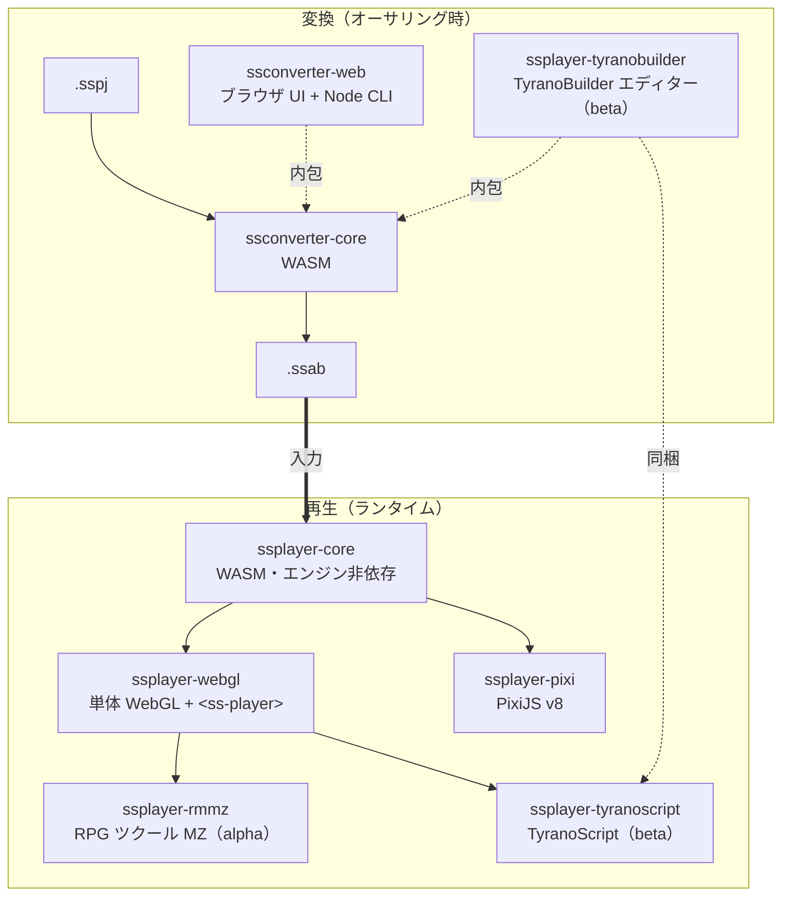

[**English**](./README.md) | [**日本語**](./README.ja.md)

# SSPlayerForWeb

**Web のためのプロ品質 2D アニメーション。WebAssembly 製の単一コアを、モダンな PixiJS や依存ゼロの単体 WebGL エンジンで描画する。**

**[SpriteStudio](https://www.webtech.co.jp/spritestudio/)** で制作したアニメーション (`.ssab`) を Web ブラウザ上で再生する高性能プレイヤーです。すでにお持ちのスプライト素材 (PNG / WebP) を専用エディタでアニメーションさせ、動画ファイルも作り直しも不要で、お好みのレンダリングエンジンからブラウザで再生できます。

## 🌐 ブラウザで試す

インストール不要、すべてブラウザ上で動作します（🚧 初回リリースの公開後に有効になります）:

- 🛠️ **[ssconverter-web](https://cri-middleware.github.io/SSPlayerForWeb/ssconverter/)** — `.sspj` → `.ssab` をブラウザ内で変換（まずはここから）
- ▶️ **[単体 WebGL サンプル](https://cri-middleware.github.io/SSPlayerForWeb/examples/webgl/)** — 依存ゼロの単体レンダラー（`<ss-player>` Web コンポーネント）。※`.ssab` のD&D再生に対応
- ▶️ **[PixiJS サンプル](https://cri-middleware.github.io/SSPlayerForWeb/examples/pixi/)** — PixiJS v8 アプリ向け。※`.ssab` のD&D再生に対応
- ▶️ **[RPG ツクール MZ サンプル](https://cri-middleware.github.io/SSPlayerForWeb/examples/rmmz/)** — サンプル MZ プロジェクト（SpriteStudio ピクチャ）
- ▶️ **[TyranoScript サンプル](https://cri-middleware.github.io/SSPlayerForWeb/examples/tyranoscript/)** — `[ss_*]` タグで動かすヴィジュアルノベルのシーン（beta）
- 🎨 **[パーツ上書きサンプル](https://cri-middleware.github.io/SSPlayerForWeb/examples/override/)** — パーツの色 / セル / 表示を実行時に差し替え（PixiJS）

## 📚 ドキュメント

詳細なドキュメントは `docs/` フォルダ内で提供しています（VitePress にてホスティング）。読者の目的に応じて段階的に読み進められる構成です。

- [**ドキュメントサイト (ホスト版)**](https://cri-middleware.github.io/SSPlayerForWeb/ja/) — 🚧 初回リリース後に公開
- [**日本語ドキュメント**](./docs/ja/index.md) · [**English docs**](./docs/index.md)
- [**SpriteStudio Docs（ポータル）**](https://cri-middleware.github.io/SpriteStudio-Docs/ja/) — SDK と全公式 Player の入口 — 🚧 初回リリース後に公開

### クイックリンク (日本語)
- [インストール](./docs/ja/setup/install.md)
- [クイックスタート](./docs/ja/setup/quickstart.md)
- [基本的な使い方](./docs/ja/usage/basic.md)
- [制限事項と対応範囲](./docs/ja/limitations.md)
- [SS6Player for Web からの移行](./docs/ja/migration_from_ss6.md)

## 🎯 どのパッケージを使うか

各レンダラーは WASM コアを同梱しているので、インストールするのは1つだけ — 環境に合う行を選んでください。**そのスタック（PixiJS / 素の WebGL …）で SpriteStudio を選ぶ理由**は各パッケージの README に記載しています。

| あなたの環境 | パッケージ | 実行できるサンプル |
|---|---|---|
| **単体 / フレームワーク非依存**（`<ss-player>` Web Component） | [`@spritestudio/ssplayer-webgl`](./packages/ssplayer-webgl) | [examples/webgl-example](./examples/webgl-example) |
| **PixiJS v8 アプリ** | [`@spritestudio/ssplayer-pixi`](./packages/ssplayer-pixi) | [examples/pixi-example](./examples/pixi-example) |
| **自作レンダラーを実装する** | [`@spritestudio/ssplayer-core`](./packages/ssplayer-core) | — |
| **`.sspj` → `.ssab` を変換する** | [`ssconverter-web`](./packages/ssconverter-web)（Web ツール + Node CLI） | — |
| **変換機能を自作アプリ/サービスに組み込む** | [`@spritestudio/ssconverter-core`](./packages/ssconverter-core) | — |

**ゲームエンジン統合** — `ssplayer-webgl` の上に載る薄いアダプターです。npm ではなくプラグインとして導入します。RPG ツクール MZ は **alpha**、Tyrano 系の 2 つは **beta** です:

| あなたの環境 | パッケージ | 実行できるサンプル |
|---|---|---|
| **RPG ツクール MZ**（PixiJS v5） | [`@spritestudio/ssplayer-rmmz`](./packages/ssplayer-rmmz) | [examples/rmmz-example](./examples/rmmz-example) |
| **TyranoScript**（ノベルエンジン） | [`@spritestudio/ssplayer-tyranoscript`](./packages/ssplayer-tyranoscript) | [examples/tyranoscript-example](./examples/tyranoscript-example) |
| **ティラノビルダー**（ノベル制作エディタ） | [`@spritestudio/ssplayer-tyranobuilder`](./packages/ssplayer-tyranobuilder) | — |

## 🚀 クイックスタート

**自分のプロジェクトで使う場合**はこのまま下へ。最初の 1 体から先（イベント、パーツ単位の
上書き、テクスチャ差し替え）も同じ道の続きで、[カスタマイズ](./docs/ja/customize/events.md)にあります。
**SSPlayerForWeb 自体を開発する場合**は下の[チェックアウトからサンプルを動かす](#チェックアウトからサンプルを動かす)、その後 [CONTRIBUTING.md](./CONTRIBUTING.md) へ。

### 導入する

> 🚧 パッケージは **まだ npm に公開されていません**。この導線は初回リリース後に利用できます。それまでは下のチェックアウト経由でお試しください。

Rust / WASM ツールチェーンは不要です（WASM は各レンダラーパッケージに同梱）。環境に合ったレンダラーを入れて（上の表を参照）、`.sspj`（**SpriteStudio 7.5 以上**で作成されたもの）を `.ssab` に変換し、数行で再生できます。詳しい手順はドキュメントにあります:

**[インストール](./docs/ja/setup/install.md)** · **[クイックスタート](./docs/ja/setup/quickstart.md)** · **[アセットの準備（.sspj → .ssab）](./docs/ja/usage/assets.md)**

### チェックアウトからサンプルを動かす

🚧 こちらが 2 つめの扉です。パッケージ公開前に評価したい場合か、本体を開発する場合の入口。

**前提条件:** [Node.js](https://nodejs.org/) と [pnpm](https://pnpm.io/)（本リポジトリは pnpm workspaces を使用します）。以下の手順は **プリビルド** の WASM コアを取得するため、Rust ツールチェーンは不要です。

```bash
git clone https://github.com/cri-middleware/SSPlayerForWeb.git
cd SSPlayerForWeb
git submodule update --init --recursive  # SpriteStudio-SDK（サンプル素材＋コア）を取得
pnpm install                             # 依存関係のインストール & ワークスペースの初期化
pnpm run download:wasm                   # プリビルド WASM を取得（macOS・Windows 共通）
pnpm run build                           # すべての TypeScript パッケージをビルド
pnpm run deploy-examples                 # examples が読み込む .ssab アセットを生成
cd examples/webgl-example
pnpm run dev                             # 開発サーバを起動してアニメーションを確認
```
examples は **ビルド済み** のパッケージをワークスペース参照で利用します。`packages/` 配下の TypeScript を変更したら `pnpm run build` を、サンプルプロジェクトを編集したら `pnpm run deploy-examples` を再実行してください。

**WASM コアをソースからビルド**（Rust コアを変更する場合のみ）: `pnpm run download:wasm` を `pnpm run build:wasm` に置き換えるだけで、他の手順は同じです。追加で **Rust（[rustup](https://rustup.rs/) 経由）** と **wasm-pack**（`cargo install wasm-pack`）が必要です。変更を貢献する場合は、[CONTRIBUTING.md](./CONTRIBUTING.md) にコーディング規約と WASM FFI のルールがあります。

## 💡 概要

### monorepo 構成

`pnpm` ワークスペースで構成し、描画をアニメーションロジックから完全に分離しています:



- **[`ssplayer-core`](./packages/ssplayer-core)** がタイムラインと WASM 処理をすべて担い、各フレームを素の描画データとしてレンダラーへ渡します（DOM・エンジンに非依存）。各レンダラーはその上に載る薄いバインディングなので、新規レンダラーの追加（[ROADMAP](./ROADMAP.md) 参照）はそのパッケージだけで完結します。`ssplayer-rmmz` / `ssplayer-tyranoscript` はさらに `ssplayer-webgl` を再利用します。また `ssplayer-tyranobuilder` は、TyranoScript ランタイムを同梱し、エディター内で `.sspj` を変換するオーサリング時ツールです。
- **[`ssconverter-core`](./packages/ssconverter-core)** は独立した変換用 WASM コア（Rust `libssconverter` のビルド）で、バイト入力・バイト出力の設計は同じ。ブラウザ・Node・Worker・エッジランタイムのいずれでも同じ変換器が動きます。ビルド環境の外では、デスクトップの [SSConverterGUI](https://github.com/cri-middleware/SSConverterGUI/releases) が同じ工程を担います。

各パッケージの詳細（API・オプション）は上の表からリンクした各 README を参照してください。

## 🎬 サンプル

すぐ動かせるサンプルアプリは [`examples/`](./examples/) にあります（レンダラーごとに1つ。上の環境別テーブルからリンクしています）。レンダラーに紐づかないものも 3 つあり、[`examples/sspj-preview`](./examples/sspj-preview) は `.sspj` のフォルダをドロップするとその場で変換して再生するサンプルで、シークバーとイベントのマーカー（クリックでその位置へシーク）付き（`ssconverter-core` + `ssplayer-webgl`。サーバもビルドも不要）、[`examples/part-follow`](./examples/part-follow) はパーツの実トランスフォームに HTML 要素を追従させるサンプル、[`examples/cdn`](./examples/cdn) はバンドラーも `npm install` も使わず CDN から直接読み込む 1 ファイル完結のページ 3 種です。先にパッケージをビルドし（[クイックスタート](#チェックアウトからサンプルを動かす)参照）、各サンプルの開発サーバを起動してください。PixiJS および WebGL のサンプルでは、`.ssab` ファイル（およびテクスチャ）を含むフォルダ、または embedded な `.ssab` ファイルをブラウザにドラッグ＆ドロップすることで、手元のアセットを再生できる機能が備わっています。

## 🔗 関連リポジトリ

- [SpriteStudio-SDK](https://github.com/cri-middleware/SpriteStudio-SDK) — `libssruntime` および `libssconverter` を提供するコア SDK です。
- [SSConverterGUI](https://github.com/cri-middleware/SSConverterGUI) — `.sspj` から `.ssab` へ変換するためのデスクトップ GUI ツールです。

## 📄 ライセンス

このプロジェクトは BSD-3-Clause License の下でライセンスされています。詳細は [LICENSE.md](./LICENSE.md) ファイルを参照してください。参考訳は [LICENSE.ja.md](./LICENSE.ja.md) にあります。

同梱の `SpriteStudio-SDK` およびその他のサードパーティライブラリのライセンスは [THIRD_PARTY_NOTICES.md](./THIRD_PARTY_NOTICES.md) を参照してください。困ったときは [SUPPORT.md](./SUPPORT.md) を、参加にあたっては [行動規範（Code of Conduct）](./CODE_OF_CONDUCT.md) をご覧ください。
