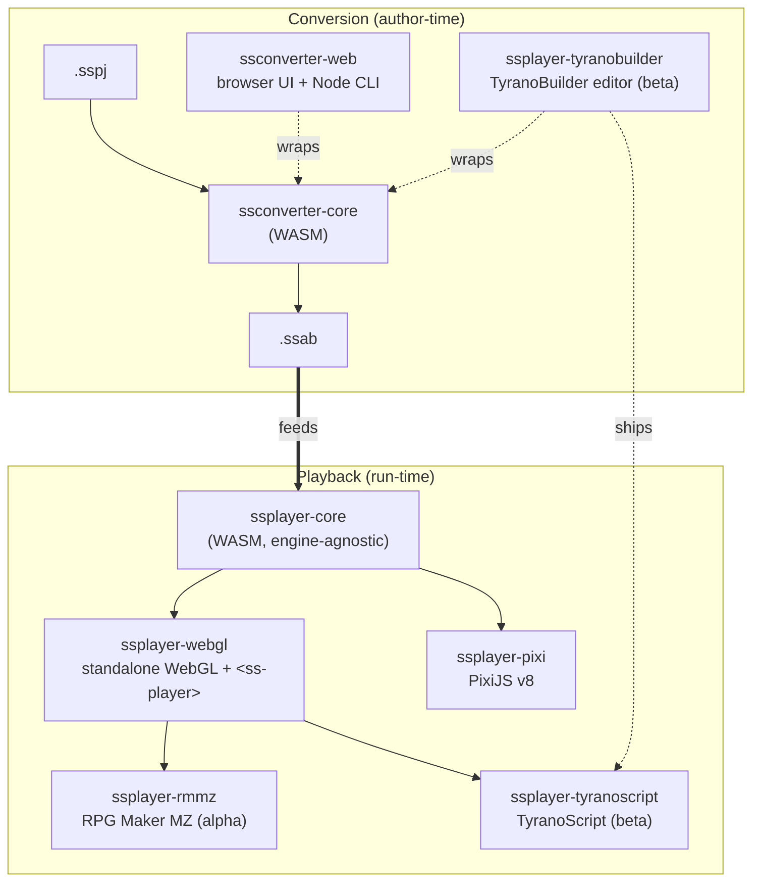

[**English**](./README.md) | [**日本語**](./README.ja.md)

# SSPlayerForWeb

**Professional 2D animation for the Web — one WebAssembly-powered core, rendered through modern PixiJS or a zero-dependency standalone WebGL engine.**

A high-performance player for **[OPTPiX SpriteStudio 7](https://www.webtech.co.jp/spritestudio/)** animations (`.ssab`) on the Web. Animate the sprite art you already have (PNG / WebP) in a dedicated editor, then play it back in the browser through the rendering engine of your choice — no video files, no re-authoring.

## 🌐 Try it live

No install — these run entirely in your browser (🚧 live once the first release is published):

- 🛠️ **[ssconverter-web](https://cri-middleware.github.io/SSPlayerForWeb/ssconverter/)** — convert `.sspj` → `.ssab` entirely client-side (start here)
- ▶️ **[Standalone WebGL example](https://cri-middleware.github.io/SSPlayerForWeb/examples/webgl/)** — zero-dependency standalone renderer (the `<ss-player>` Web Component). *Supports D&D of `.ssab` files.*
- ▶️ **[PixiJS example](https://cri-middleware.github.io/SSPlayerForWeb/examples/pixi/)** — for PixiJS v8 apps. *Supports D&D of `.ssab` files.*
- ▶️ **[RPG Maker MZ example](https://cri-middleware.github.io/SSPlayerForWeb/examples/rmmz/)** — a sample MZ project (SpriteStudio pictures)
- ▶️ **[TyranoScript example](https://cri-middleware.github.io/SSPlayerForWeb/examples/tyranoscript/)** — a visual-novel scene driven by `[ss_*]` tags (beta)

## 📚 Documentation

Comprehensive documentation lives in the `docs/` folder (hosted via VitePress) and is structured step-by-step according to what you want to do:

- [**Documentation site (hosted)**](https://cri-middleware.github.io/SSPlayerForWeb/) — 🚧 live after the first release
- [**Documentation (English)**](./docs/index.md) · [**日本語ドキュメント**](./docs/ja/index.md)

### Quick Links
- [Installation](./docs/setup/install.md)
- [Quick Start](./docs/setup/quickstart.md)
- [Basic Usage](./docs/usage/basic.md)
- [Asset Preparation](./docs/usage/assets.md)
- [WebGL Standalone & Web Components](./docs/usage/webgl.md)
- [PixiJS Integration](./docs/usage/pixi.md)
- [Migrating from SS6Player for Web](./docs/migration_from_ss6.md)

### Where to read, by goal
You only need to read as far as your goal requires:

| You are… | Your goal | Where to read |
|---|---|---|
| **A general user** | Just get animations running | [Quick Start](./docs/setup/quickstart.md) → [Basic Usage](./docs/usage/basic.md) |
| **A customization user** | Polish expressions and add logic | Above + [Customization](./docs/customize/events.md) |
| **An SDK / player developer** | Extend or contribute to the core | Above + [CONTRIBUTING.md](./CONTRIBUTING.md) |

## 🎯 Which Package Should I Use?

Each renderer bundles the WASM core, so you install just one package — pick the row that matches your environment. Each package's README explains **why you'd choose SpriteStudio for that specific stack** (PixiJS, plain WebGL, …).

| Your environment | Package | Runnable example |
|---|---|---|
| **Standalone / no framework** (`<ss-player>` Web Component) | [`@spritestudio/ssplayer-webgl`](./packages/ssplayer-webgl) | [examples/webgl-example](./examples/webgl-example) |
| **PixiJS v8 app** | [`@spritestudio/ssplayer-pixi`](./packages/ssplayer-pixi) | [examples/pixi-example](./examples/pixi-example) |
| **Building your own renderer** | [`@spritestudio/ssplayer-core`](./packages/ssplayer-core) | — |
| **Converting `.sspj` → `.ssab`** | [`ssconverter-web`](./packages/ssconverter-web) (Web tool + Node CLI) | — |
| **Embedding conversion in your own app/service** | [`@spritestudio/ssconverter-core`](./packages/ssconverter-core) | — |

**Game-engine integrations** — thin adapters on top of `ssplayer-webgl`, installed as plugin bundles rather than from npm. RPG Maker MZ is **alpha**; the two Tyrano integrations are **beta**:

| Your environment | Package | Runnable example |
|---|---|---|
| **RPG Maker MZ** (PixiJS v5) | [`@spritestudio/ssplayer-rmmz`](./packages/ssplayer-rmmz) | [examples/rmmz-example](./examples/rmmz-example) |
| **TyranoScript** (visual-novel engine) | [`@spritestudio/ssplayer-tyranoscript`](./packages/ssplayer-tyranoscript) | [examples/tyranoscript-example](./examples/tyranoscript-example) |
| **TyranoBuilder** (visual-novel editor) | [`@spritestudio/ssplayer-tyranobuilder`](./packages/ssplayer-tyranobuilder) | — |

## 🚀 Quick Start

There are two ways in — pick the one that matches you:

- **A. Run the examples from this repo** — to evaluate SSPlayerForWeb or work on it locally.
- **B. Use it in your own project** — to install the packages into an app you're building.

### A. Run the examples from this repo

**Prerequisites:** [Node.js](https://nodejs.org/) and [pnpm](https://pnpm.io/) (this repo uses pnpm workspaces). The steps below fetch the **pre-built** WASM core, so no Rust toolchain is required.

```bash
git clone https://github.com/cri-middleware/SSPlayerForWeb.git
cd SSPlayerForWeb
git submodule update --init --recursive  # SpriteStudio-SDK (sample source + core)
pnpm install                             # install deps & initialize the workspace
pnpm run download:wasm                   # fetch the pre-built WASM (macOS & Windows alike)
pnpm run build                           # build all TypeScript packages
pnpm run deploy-examples                 # generate the .ssab assets the examples load
cd examples/webgl-example
pnpm run dev                             # open the dev server and see the animation
```
The examples consume the **built** packages via workspace references — re-run `pnpm run build` whenever you change TypeScript under `packages/`, and `pnpm run deploy-examples` if you edit the sample projects.

**Building the WASM core from source** (only if you modify the Rust core): replace `pnpm run download:wasm` with `pnpm run build:wasm` — everything else is identical. This additionally needs **Rust** (via [rustup](https://rustup.rs/)) and **wasm-pack** (`cargo install wasm-pack`). Contributing the change back? [CONTRIBUTING.md](./CONTRIBUTING.md) covers the coding standards and WASM FFI rules.

### B. Use it in your own project

> 🚧 The packages are **not published to npm yet** — this path opens up after the first release. Until then, use **Track A** to try things locally.

No Rust or WASM toolchain needed — the WASM ships inside each renderer package. Install the renderer for your environment (see the table above), convert your `.sspj` → `.ssab`, and play it in a few lines. The full walkthrough lives in the docs:

**[Installation](./docs/setup/install.md)** · **[Quick Start](./docs/setup/quickstart.md)** · **[Preparing assets (.sspj → .ssab)](./docs/usage/assets.md)**

## 💡 Overview

### Monorepo Structure

This project uses `pnpm` workspaces, layered so that rendering stays fully decoupled from the animation logic:



- **[`ssplayer-core`](./packages/ssplayer-core)** does the timeline and WASM work, then hands each frame to a renderer as plain draw data — no DOM, no engine assumptions. Every renderer is a thin binding on top of it, so adding one (see the [ROADMAP](./ROADMAP.md)) touches only that package; `ssplayer-rmmz` and `ssplayer-tyranoscript` further build on `ssplayer-webgl`, and `ssplayer-tyranobuilder` is author-time tooling that ships the TyranoScript runtime and converts `.sspj` inside the editor.
- **[`ssconverter-core`](./packages/ssconverter-core)** is a separate WASM core (a build of the Rust `libssconverter`) with the same bytes-in / bytes-out design, so the same converter runs in the browser, Node, a Worker, or an edge runtime — the desktop [SSConverterGUI](https://github.com/cri-middleware/SSConverterGUI/releases) covers the same step outside a build.

Per-package details live in each package's README, linked from the tables above.

## 🎬 Samples

Ready-to-run example apps live under [`examples/`](./examples/) — one per renderer, each linked from the per-environment tables above. Build the packages first ([Quick Start](#a-run-the-examples-from-this-repo)), then start any example's dev server. For the PixiJS and WebGL examples, you can drag and drop a folder containing an `.ssab` file (and its textures) or an embedded `.ssab` file directly into the browser to play your own assets.

## 🔗 Related Repositories

- [SpriteStudio-SDK](https://github.com/cri-middleware/SpriteStudio-SDK) — the core SDK providing `libssruntime` and `libssconverter`.
- [SSConverterGUI](https://github.com/cri-middleware/SSConverterGUI) — desktop GUI tool for converting `.sspj` to `.ssab`.

## 📄 License

This project is licensed under the BSD-3-Clause License. See [LICENSE.md](./LICENSE.md) for details.

For the licenses of the bundled `SpriteStudio-SDK` and other third-party libraries, see [THIRD_PARTY_NOTICES.md](./THIRD_PARTY_NOTICES.md). Need help? See [SUPPORT.md](./SUPPORT.md); participation is governed by our [Code of Conduct](./CODE_OF_CONDUCT.md).
