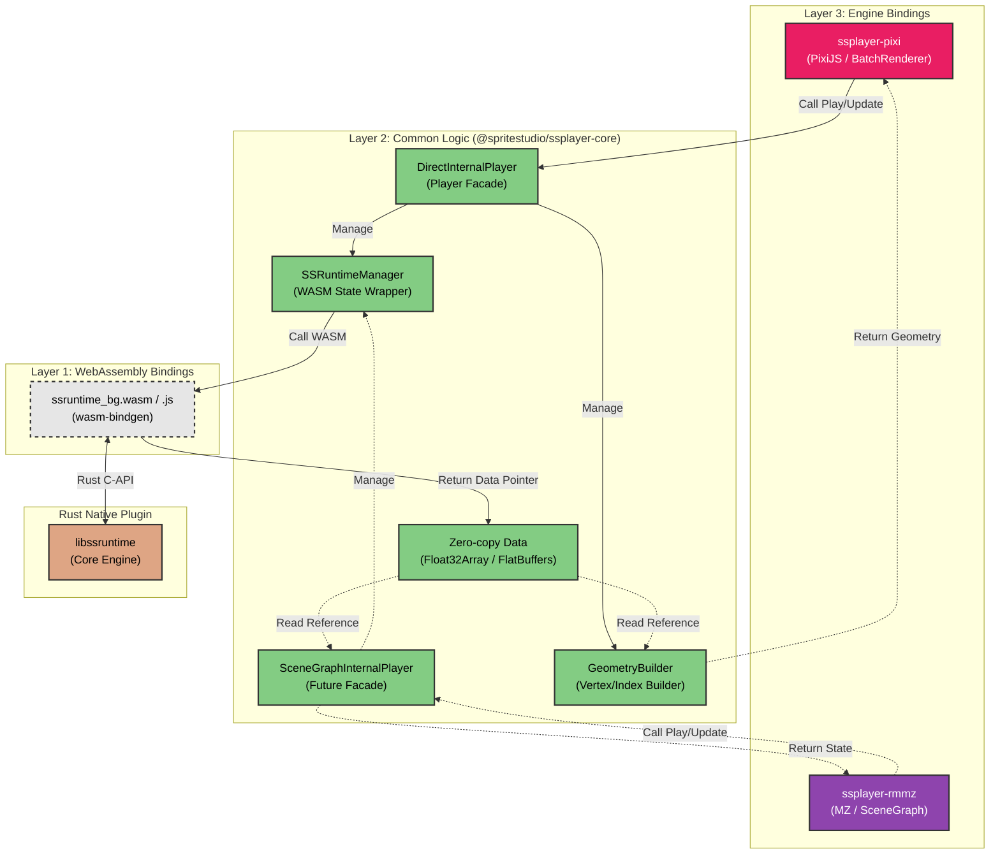

# SSPlayerForWeb

SpriteStudio7-SDK Player for Web.

## Overview

SSPlayerForWeb is a high-performance, WebAssembly-powered player for SpriteStudio 7 animations. It is designed to be highly adaptable and deployable across various Web graphics engines, ranging from modern PixiJS to legacy environments like RPG Maker MZ (PixiJS v5) and Three.js.

## Key Features

- **Multi-Engine Support (Package Separation):** A completely independent core logic package with multiple engine-specific rendering packages.
- **Hybrid Architecture (WASM Brain + JS Body):** WebAssembly (Rust) handles heavy interpolation and matrix calculations, while JavaScript handles the final rendering, achieving zero unnecessary object creation (GC-free updates).
- **Optimized Rendering:** Supports both "Direct Drawing" (Batch Rendering) for high-performance modern engines and "SceneGraph Drawing" for legacy compatibility.

## Monorepo Structure

This project uses `pnpm` workspaces for package management.

### Core
- **`@spritestudio/ssplayer-core`**: The engine-agnostic core logic layer. Manages WASM initialization, time updates, and zero-copy data extraction. It has zero dependencies on DOM APIs or specific rendering engines.

### Renderers (Engine Bindings)
- **`@spritestudio/ssplayer-pixi`**: Optimized for PixiJS v8. Uses direct drawing (BatchRenderer) for maximum performance.
- **`@spritestudio/ssplayer-rmmz`**: Designed for RPG Maker MZ (PixiJS v5). Uses SceneGraph drawing for seamless integration with the engine's Sprite tree.

## Development

### Prerequisites
- Node.js & `pnpm`
- Rust & `wasm-pack`

### Development Workflow

1. **Build WASM (if Rust code is modified)**
   ```bash
   pnpm run build:wasm
   ```
   *(For Windows users, use: `pnpm run build:wasm:win`)*

2. **Build TypeScript Packages**
   ```bash
   pnpm run build
   ```

3. **Run Examples (Dev Server)**
   You can test your changes using the Vite dev server provided in the `examples` directory.
   ```bash
   cd examples/pixi-example
   pnpm run dev
   ```
   *(Note: Since the examples consume the built packages via workspace references, you must re-run `pnpm run build` from the project root whenever you modify the TypeScript source code in `packages/`.)*

## Architecture

### 3-Layer Architecture



### Robustness & Zero-Copy

- **Memory Leak Prevention:** Uses `FinalizationRegistry` to automatically call WASM `free()` when JS objects are garbage-collected.
- **Zero-Duplication:** Uses `Float32Array` mapped directly to `wasmMemory.buffer` to pass transformation matrices without copying memory.
- **Asset Pipeline:** Caches parsed `SSRuntimeResource` instances so multiple player instances share the same WASM memory footprint for assets.
