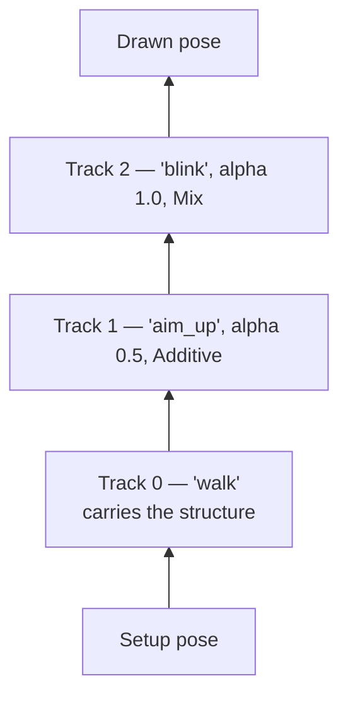

# Motion blending

Play more than one animation on one character at once, and move between them without
a cut: a walk underneath, an aiming overlay on top, a one-shot reaction crossfaded in —
each authored by the artist as an animation of its own.

The methods below are on `SSPlayer` in both the PixiJS and the WebGL packages, under the
same names, and on RPG Maker MZ's `SSPlayer`. RPG Maker MZ also has plugin commands for tracks
(**Set SS Track**, **Fade SS Track**, **Clear SS Track**) and a `Transition (ms)` on its animation
commands that crossfades track 0 — see [RPG Maker MZ](/usage/rmmz). TyranoScript has `[ss_track]`,
`[ss_track_fade]` and `[ss_track_clear]`, and `transition=` on `[ss_play]` — see
[TyranoScript](/usage/tyrano). TyranoBuilder has no component for tracks.

## The model: a stack of tracks

Tracks fold onto the **setup pose** in ascending order. Each one carries an animation, an
**alpha** (how much of it survives onto the pose below) and a **blend**.



**Track 0 is special.** It is what `setAnimation` establishes, and it carries the
structure: the cells, visibility, part colors and draw order, the events, and the
playback state. `currentAnimation`, `isFinished`, the frame read-outs, the events and
(on WebGL) `canvasRect` all follow track 0's animation. The tracks above it are overlays.

| Blend | What it does |
|---|---|
| `SSTrackBlend.Mix` | Moves toward the track's own pose; alpha 1 overrides fully |
| `SSTrackBlend.Additive` | Adds the track's **offset from the setup pose**, so what is below shows through — for aiming, leaning and breathing |

A track only affects the attributes its animation keys. An overlay keyed on the head
leaves the legs alone, with no mask to set up: how far an overlay reaches is how far the
artist keyed it.

## Laying an overlay

```ts
import { SSTrackBlend } from '@spritestudio/ssplayer-pixi'; // or -webgl

player.setAnimation('walk');                  // track 0
player.play();

player.setTrackAnimation(1, 'aim_up');        // an overlay
player.setTrackBlend(1, SSTrackBlend.Additive);
player.setTrackAlpha(1, 0.5);                 // at half strength

// ... and to take it off
player.clearTrack(1);
```

`clearTrack` refuses track 0; fade it to alpha 0 instead, which settles the character
onto the setup pose.

::: warning Setting track 0 rebuilds the stack
`setAnimation` folds the stack back to track 0, and the overlays go with it. Lay them
again after switching the base animation.
:::

## Fading instead of cutting

Both fades are advanced by the player's own update. Start one and keep drawing.

```ts
// Replace what a track plays, fading from where it stands, over 400 ms.
player.crossfade(0, 'run', 400);

// Move a track's alpha over 250 ms.
player.fadeTrack(1, 0, 250);   // take the overlay out
player.fadeTrack(0, 0, 600);   // settle the whole character onto the setup pose

const t = player.getTrackFadeProgress(0); // 0..1, or undefined when not fading
player.cancelTrackFade(1);
```

### What a crossfade on track 0 changes, and when

The incoming animation takes track 0 over **when the fade begins**, not when it ends:

- `currentAnimation` names the incoming animation from the call on. Calling
  `setAnimation` with the name the fade left behind therefore switches back to it
  rather than doing nothing, and naming the incoming one mid-fade leaves the fade
  running. `canvasRect` (WebGL) follows too.
- What cannot be blended — cells, visibility and the like — is the incoming
  animation's from the first frame of the fade. `isFinished` and `onAnimationFinished`
  report the incoming animation's playback; the outgoing one running out mid-fade does
  not finish the player.
- The incoming animation's events fire from the start of the fade, and the outgoing
  one's stop (see [Events](/customize/events)).
- The incoming animation plays with the playback settings you set on the player —
  `speedScale`, `frameRate`, `frameSkipEnabled`, the direction and `loopCount` — as
  after a `setAnimation`. Its section is the whole animation.

Whatever the track was playing fades out together, in proportion. Crossfading again
mid-fade takes the fade over where it stands, so the pose does not jump — likewise
after `cancelTrackFade`, or from a track mixing several animations.

::: tip A crossfade on track 0 does not rebuild the instance children
That is what makes it a fade rather than a switch. Instance and effect parts belong to
the pack, not to one animation, so the children are the same whichever animation plays,
and the running ones carry on. They are outside motion blending (see the limits below).
:::

## Mixing two animations on one track

A track can carry more than one animation, mixed by **weight** — a walk and a run
blended by how fast the character moves. Each one is a *source*, named by a handle:

```ts
player.setAnimation('walk');
player.play();
const walk = player.getTrackMainSource(0)!;
const run = player.addTrackSource(0, 'run', 0); // beside the walk, silent for now

// every frame, from the character's speed
player.setSourceWeight(walk, 1 - t);
player.setSourceWeight(run, t);
```

- Weights are **ratios within the track**: `(0.7, 0.3)` and `(7, 3)` mix alike. The
  track's strength is still its alpha.
- A walk and a run of different lengths drift apart. Set the track's sync to
  `SSTrackSync.Start` before laying the run (next section) to start them in step, or
  seek one with `setSourceFrame`.
- A handle is valid until its source is released — by a crossfade completing,
  `clearTrack`, `setTrackAnimation` on its track or `setAnimation` — and is then reused, so drop it then.

## Starting in step with track 0

An animation laid on a track starts at the head of its section, so a run laid over a
walk in mid-stride puts the feet out of step. Set the track's **sync** to
`SSTrackSync.Start` and every animation laid on it afterwards starts at the **phase**
track 0 stands at — how far through its section it is, from 0 at the start to 1 at the
end — so animations of different lengths line up too:

```ts
import { SSTrackSync } from '@spritestudio/ssplayer-pixi'; // or -webgl

player.setTrackSync(0, SSTrackSync.Start); // set it before laying
player.crossfade(0, 'run', 400);           // the run starts at the walk's phase
```

| Sync | Where an animation laid on the track starts | Suits |
|---|---|---|
| `SSTrackSync.Free` (default) | The head of its section | One-off motions: a blink, a mouth shape, a hit reaction |
| `SSTrackSync.Start` | The same proportion of its section as track 0's animation | Cyclic motions layered together: a walk and a run |

- It covers every way of laying an animation on the track: `setTrackAnimation`,
  `crossfade` (track 0's too — the incoming animation starts at the outgoing one's
  phase) and `addTrackSource`.
- They are matched **once**, when laid. After that both run on the one clock, so they
  stay in step only while their lengths and speeds agree.
- It is a track setting, like alpha and blend, and `setAnimation` puts every track back
  to `Free`.

## A track's playback settings

Speed, the frame-rate override, frame skipping and the direction belong to the
**track**, not to the animation on it. They reach every animation on the track — both
sides of a crossfade — and every one laid on it later.

```ts
import { WebPlaybackDirection, WebPlaybackStyle } from '@spritestudio/ssplayer-pixi'; // or -webgl

player.setTrackSpeed(1, 0.5);
player.setTrackFrameRate(1, 24);
player.setTrackFrameSkipEnabled(1, false);
player.setTrackPlaybackDirection(1, WebPlaybackDirection.Forward, WebPlaybackStyle.PingPong);
```

Track 0's settings are the playback settings themselves (`speedScale` is track 0's
`setTrackSpeed`, and so on). The **loop count** alone belongs to the animation rather
than the track: laying an animation starts it looping forever, so set the count after
laying and watch for the track to finish. Track 0's count is `loopCount`, and
`setTrackLoopCount(0, …)` writes the same value; the player puts it back every time
track 0 changes hands.

```ts
player.setTrackAnimation(2, 'hit_react');
player.setTrackAlpha(2, 1);      // a track keeps the alpha its last fade left
player.setTrackLoopCount(2, 1);  // play once, then hold the last frame

// every frame
if (player.isTrackFinished(2) && player.getTrackFadeProgress(2) === undefined && (player.getTrackAlpha(2) ?? 0) > 0) {
  player.fadeTrack(2, 0, 120);   // once; a finished track holds its last frame until you act
}
```

`trackJustLooped(track)` is a per-update pulse, as `justLooped` is for track 0. The
player raises no listener for another track finishing or looping; `onAnimationFinished`
is track 0's alone.

**Track 0 finishing does not stop the character's clock.** The tracks above it and any
fade carry on, and `isFinished` turns true as usual. `stop()` stops all of it.
`pause()` and `resume()` hold and lift all of it too. `isPlaying` and `isPausing`
describe track 0, though, so once track 0 has finished both stay false, through a
pause as well.

## Scrubbing a track: continuous control

Author the control axis itself as an animation — a head turning from one side to the
other, an eyelid opening — and do not play it. **Scrub** it with the value you track:

```ts
player.setTrackAnimation(1, 'look_lr');
player.setTrackBlend(1, SSTrackBlend.Additive);
player.setTrackSpeed(1, 0);               // it does not advance by itself
player.setTrackFrame(1, headYawFrame);    // ... you move it
```

The face then follows the camera or the mouse with no blend authored per frame: the
artist makes the two ends, and the application picks the point between them.

## A worked shape

A common three-track layout for an in-game character:

| Track | Animation | Blend | Driven by |
|---|---|---|---|
| 0 | `idle` / `walk` / `run` | — | `crossfade(0, …, 200)` on a state change |
| 1 | `aim_lr` | Additive, speed 0 | `setTrackFrame` from the aiming angle |
| 2 | `hit_react` | Mix | `setTrackAnimation` + `setTrackAlpha(2, 1)` + `setTrackLoopCount(2, 1)`, faded out once after `isTrackFinished(2)` |

`trackCount`, `getTrackAlpha(track)`, `getTrackBlend(track)`, `getTrackSync(track)`,
`getTrackFrame(track)`, `getTrackSpeed(track)`, `getTrackLoopCount(track)` and the other
`getTrack*` reads show what is on the stack. A read of a track or source that is not
there answers `undefined`; a command on one throws an `Error` naming the call.

## The `<ss-player>` element

`el.player` is the WebGL `SSPlayer`, so everything above is available on it. The
`animation` attribute keeps switching with `setAnimation`: writing it after a crossfade
compares it with what track 0 plays now, so writing back the name the crossfade left
behind switches back to it.

## Limits

- **Instance children are not layered.** A part playing an animation from another pack
  runs its own playback context, driven by its slot from the root's frame. The tracks
  act on the character you hold. Effect parts are the same, and which keys drive the
  children across a crossfade on track 0 is outside motion blending too.
- **The track's alpha is the strength.** When several animations share a track, a
  source's *weight* only sets their proportions; it is not a second volume knob.
- **Only animations in the same `.ssab`** can be stacked.
