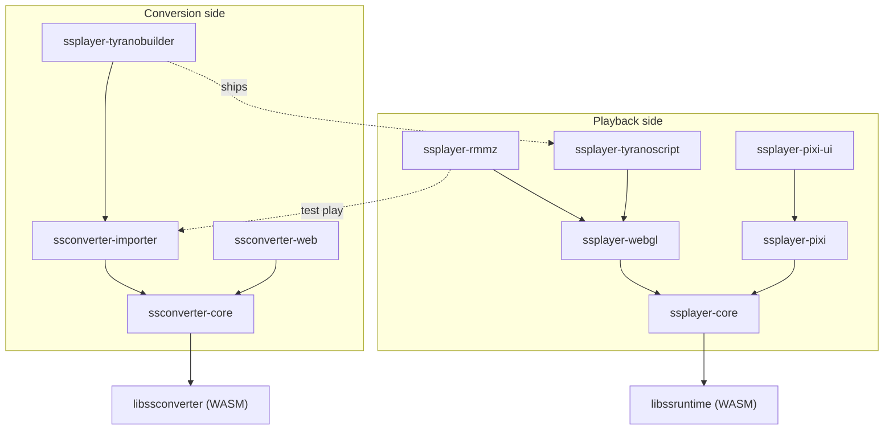

# How the Player Is Put Together

For whoever works on SpriteStudio Player for Web, or changes it for a project of their own. It
describes the parts by what they do; the [Build Guide](/development/build) builds them, puts a
changed build into a game or an app, and checks it in the real hosts. Each package's README ends
with a section for contributors that goes into that package.

What every SpriteStudio Player shares — how playback, motion blending, sound keys and part
tracking behave — is written once, in the SDK's
[porting guide](https://github.com/cri-middleware/SpriteStudio-SDK/tree/develop/libs/ssruntime/docs).

## Layers {#layers}

The workspace has two sides. A solid arrow is a call; the dotted ones are a test play running the
importer, and a plugin folder carrying a runtime.

**The playback side** runs in a page or a game.

- `ssplayer-core` turns each frame of the runtime's WebAssembly build into draw data. It knows no
  DOM and no engine.
- `ssplayer-webgl` draws that data on raw WebGL and gives a page `<ss-player>`; `ssplayer-pixi`
  draws it as a PixiJS display object. `ssplayer-pixi-ui` is a package of its own because it
  brings `@pixi/ui` with it, which an app that only plays animations should not have to install.
- `ssplayer-rmmz` is the RPG Maker MZ plugin: an animation belongs to a picture, so MZ moves it,
  scales it and saves it with the game, and the plugin's commands drive it.
  `ssplayer-tyranoscript` is the `[ss_*]` tags, and is also the runtime half of TyranoBuilder and
  TyranoStudio: each character is a `
` on a Tyrano layer, and its state rides in the save.

**The conversion side** turns `.sspj` into `.ssab`.

- `ssconverter-core` is the converter's WebAssembly build, and `ssconverter-web` the converter
  page and its Node CLI.
- `ssconverter-importer` is the auto importer the editor plugins share. It finds the projects that
  changed, converts them, records what each conversion wrote and logs what it did. TyranoBuilder
  runs it when a project opens, MZ when a test play starts. Its
  [README](https://github.com/cri-middleware/SSPlayerForWeb/tree/main/packages/ssconverter-importer)
  says what a host supplies.
- `ssplayer-tyranobuilder` is TyranoBuilder's editor half: the components on the palette, the
  panel in the plugin manager, and the importer as the builder runs it. One plugin folder carries
  it together with the TyranoScript runtime.

## Why it is built the way it is {#why-it-is-built-the-way-it-is}

Each reason here spans packages; the code it concerns carries the detail in its comments.

**Each host's plugin draws on the host's own GL context.** The MZ plugin registers a renderer with
MZ's PixiJS and brackets its raw draw with the same state save and restore MZ's own Effekseer
sprite uses, so animations sort with MZ's sprites and no canvas sits on top. The TyranoScript
plugin keeps one canvas per Tyrano layer and positions each character from its `
`: a browser
allows only about 8 to 16 WebGL contexts, and the `
` is what `[anim]` and `[kanim]` find by
name.

**MZ gets the runtime without SIMD.** MZ's NW.js is a Chromium without WebAssembly SIMD, and the
default runtime needs it: the core refuses to start it there unless told the build is the scalar
one. So the MZ ZIP and the MZ example carry the scalar runtime, and the Tyrano plugins carry the
SIMD one.

**Conversion happens at the host's start, and nothing watches.** All three hosts that convert
`.sspj` share one moment: the start. Ren'Py converts when the game launches in developer mode,
TyranoBuilder when a project opens, MZ when a test play starts — and F5 restarts one, so saving in
SpriteStudio and pressing F5 is MZ's whole loop. After that, Ren'Py picks up a save once its
autoreload is on (Shift+R), because a reload runs its import again. TyranoBuilder has no reload of
its own for a plugin to ride, so a watch would be the plugin's own, on the editor's thread: a
polling pass costs one `stat` per source file, each a synchronous hop across Electron's
`contextBridge` on the thread that draws the editor — while the author is in SpriteStudio anyway.
So the builder converts on request: **Import now** (**Project → Plugins** → **SpriteStudio**) runs
the same pass as a project open, and **Reconvert now** on a **SpriteStudio: show** component
rebuilds its one pack.

**The builder reports success as a toast and problems as a dialog.** A reconversion usually
finishes while the author is in SpriteStudio, and a modal would take focus from the app they are
using. A failed conversion is a dialog because the reason is in it and the editor has no console to
fall back on; a name clash is one because something has to be renamed; a project that has never
imported anything and has no `.sspj` gets one that says where projects go.

**The converter runs in a Worker; the files it reads and writes do not.** The converter call is
synchronous and long enough to freeze the editor, so it runs in a Worker started from a Blob URL,
and in the calling thread when the host cannot start one. A plugin reaches the filesystem only
through `window.studio_api`, which only the editor's thread holds, so the reads and writes around
each project stay there. Moving them is on the package's
[ROADMAP](https://github.com/cri-middleware/SSPlayerForWeb/blob/main/packages/ssplayer-tyranobuilder/ROADMAP.md).

**The importers' folders are fixed.** MZ reads `SpriteStudio_Source/` and writes `spritestudio/`;
TyranoBuilder reads `SpriteStudio_Source/` and writes `data/others/ssdata/`. The shared importer
takes both names as options, and Ren'Py's importer exposes them to the game (`ss_source_dir`,
`ss_output_dir`); these plugins do not.

**What the builder needs at edit time stays out of the exported game.** An export is three
unfiltered copies — `index.html`, `data/` and `tyrano/` — and a `.tbp` can deliver files only into
the plugin folder, under `data/`. So the plugin moves the converter's WebAssembly to `.ss_tools/`
in the project when it first finds it there, and the import record and the log sit at the project
root.

**One plugin folder, two halves.** The `.tbp` carries the editor half and the TyranoScript runtime
(`init.ks`, `main.js`, `ssruntime_bg.wasm`) in one `ssplayer/` folder. Without the runtime, a
scenario built from the components parses in the editor and fails in the game on an unknown
`[ss_init]`; as one plugin it also takes one place in the builder's plugin limit. That is why an
author installs the `.tbp` *or* the TyranoScript ZIP, never both: they unpack to the same
`data/others/plugin/ssplayer/`, and stacking them leaves the two halves on different versions.

**Where each host's importer reports.** TyranoBuilder's main window has no DevTools, so the
importer writes `<project>/ss_import_log.txt`, as it goes and across sessions. MZ's test play has
a console (F8), and its error screen already names the project and the reason, so MZ writes no log
file.
