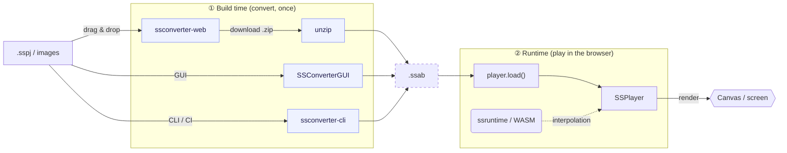

## Try it live

No install — these run entirely in your browser (🚧 live once the first release is published):

- 🛠️ **[ssconverter-web](https://cri-middleware.github.io/SSPlayerForWeb/ssconverter/)** — convert `.sspj` → `.ssab` in the browser (start here)
- ▶️ **[Standalone WebGL example](https://cri-middleware.github.io/SSPlayerForWeb/examples/webgl/)** — the `<ss-player>` Web Component
- ▶️ **[PixiJS example](https://cri-middleware.github.io/SSPlayerForWeb/examples/pixi/)** — for PixiJS v8 apps
- ▶️ **[RPG Maker MZ example](https://cri-middleware.github.io/SSPlayerForWeb/examples/rmmz/)** — a sample MZ project (experimental)
- ▶️ **[TyranoScript example](https://cri-middleware.github.io/SSPlayerForWeb/examples/tyrano/)** — a visual-novel scene (beta)

## How to read these docs

The docs are organized as a gradient: the earlier sections alone are enough to reach a working result, and each later section digs a little deeper.

[[toc]]

| You want to | Goal | Where to read |
|---|---|---|
| **Just use it** | Get something running | "Getting started" → "Usage" → "API reference" |
| **Customize it** | Craft the look | The above + "Customize" |
| **Extend the SDK / player** | Change or contribute to the internals | The above + CONTRIBUTING |

## Overview (.sspj → on screen)

You convert a `.sspj` to a `.ssab` **once, at build time**, and at **runtime** you simply load that `.ssab` and render it. There are three conversion paths: the **browser tool (`ssconverter-web`)**, the **GUI tool ([`SSConverterGUI`](https://github.com/cri-middleware/SSConverterGUI/releases))**, and the **CLI ([`ssconverter-cli`](https://github.com/cri-middleware/SpriteStudio-SDK/releases))**.

For details on the three paths (`SSConverterGUI` / `ssconverter-web` / `ssconverter-cli`), see [Preparing assets](/usage/assets).

## Packages

| Package | What it's for |
|---|---|
| [`@spritestudio/ssplayer-webgl`](/usage/webgl) | Zero-dependency standalone WebGL renderer (includes the `<ss-player>` Web Component). A good fit for frameworkless setups and drop-in use. |
| [`@spritestudio/ssplayer-pixi`](/usage/pixi) | Renderer for apps already built on **PixiJS v8**. |
| `@spritestudio/ssplayer-core` | Engine-agnostic WASM core (for writing your own renderer). |
| [`ssconverter-web`](/usage/assets) | `.sspj` → `.ssab` conversion tool (browser tool + Node CLI). |
| [`@spritestudio/ssconverter-core`](/usage/assets) | Engine-agnostic WASM conversion core (for embedding conversion in your own app). |

**Game-engine integrations** — thin adapters on top of `ssplayer-webgl` (**experimental / alpha**, private, not on npm):

| Package | What it's for |
|---|---|
| [`@spritestudio/ssplayer-rmmz`](/usage/rmmz) | Renderer / plugin for **RPG Maker MZ**. |
| `@spritestudio/ssplayer-tyranoscript` | Plugin for **TyranoScript / TyranoBuilder** (visual-novel engine). |

::: tip Coming from an older player?
Migrating from the older **[SS6Player for Web](https://github.com/SpriteStudio/SS6PlayerForWeb)** (`ss6player-pixi`)? See **[Migrating from SS6Player](/migration_from_ss6)** for the old→new API mapping and the asset re-conversion (`.ssfb` → `.ssab`) steps.
:::
