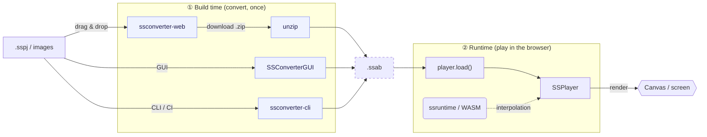

<!-- The converter and the examples are built beside this site, not by VitePress
     (pages.yml -> scripts/build-pages.sh assembles them around it), so they are
     linked by relative path rather than by absolute URL: a hardcoded
     cri-middleware.github.io link is wrong on every other deployment of this
     site -- a local `scripts/build-pages.sh` preview, a fork's Pages. VitePress
     URLs mirror the file tree, so the number of `../` is simply this file's
     directory depth.

     Raw <a> rather than markdown links, deliberately, for two reasons: VitePress
     checks markdown links against its own pages and would fail the build over
     these (they are not pages of this site), and its router would try to resolve
     them client-side and land on the 404 page. target="_blank" both keeps the
     reader's place in the docs and is what stops the router intercepting. -->

## Try it live

No install — these run entirely in your browser (🚧 live once the first release is published):

- 🛠️ **<a href="./ssconverter/" target="_blank" rel="noreferrer">ssconverter-web</a>** — convert `.sspj` → `.ssab` in the browser (start here)
- ▶️ **<a href="./examples/webgl/" target="_blank" rel="noreferrer">Standalone WebGL example</a>** — the `<ss-player>` Web Component
- ▶️ **<a href="./examples/pixi/" target="_blank" rel="noreferrer">PixiJS example</a>** — for PixiJS v8 apps
- ▶️ **<a href="./examples/rmmz/" target="_blank" rel="noreferrer">RPG Maker MZ example</a>** — a sample MZ project
- ▶️ **<a href="./examples/tyranoscript/" target="_blank" rel="noreferrer">TyranoScript example</a>** — a visual-novel scene
- 🎨 **<a href="./examples/override/" target="_blank" rel="noreferrer">Part override example</a>** — runtime colour / cell / visibility overrides (PixiJS)
- 📂 **<a href="./examples/sspj-preview/" target="_blank" rel="noreferrer">Drop a `.sspj` and play it</a>** — convert **your own** project in the tab and scrub it, user-data / signal / sound keys marked on the timeline, in the WebGL or the PixiJS player. No tool to install

## Overview (.sspj → on screen) {#overview-from-sspj-to-rendering}

You convert a `.sspj` to a `.ssab` **once, at build time**, and at **runtime** you simply load that `.ssab` and render it. There are three conversion paths: the **browser tool (`ssconverter-web`)**, the **GUI tool ([`SSConverterGUI`](https://github.com/cri-middleware/SSConverterGUI/releases))**, and the **CLI ([`ssconverter-cli`](https://github.com/cri-middleware/SpriteStudio-SDK/releases))**.

For details on the three paths (`SSConverterGUI` / `ssconverter-web` / `ssconverter-cli`), see [Preparing assets](/usage/assets).

## Packages

| Package | What it's for |
|---|---|
| [`@spritestudio/ssplayer-webgl`](/usage/webgl) | Zero-dependency standalone WebGL renderer (includes the `<ss-player>` Web Component). A good fit for frameworkless setups and drop-in use. |
| [`@spritestudio/ssplayer-pixi`](/usage/pixi) | Renderer for apps already built on **PixiJS v8**. |
| `@spritestudio/ssplayer-core` | Engine-agnostic WASM core (for writing your own renderer). |
| [`ssconverter-web`](/usage/assets) | `.sspj` → `.ssab` conversion tool (browser tool + Node CLI). |
| [`@spritestudio/ssconverter-core`](/usage/assets) | Engine-agnostic WASM conversion core (for embedding conversion in your own app). |

**Game-engine integrations** — thin adapters on top of `ssplayer-webgl`, private and not on npm
(you install them as plugin bundles):

| Package | What it's for |
|---|---|
| [`@spritestudio/ssplayer-rmmz`](/usage/rmmz) | Renderer / plugin for **RPG Maker MZ**. |
| [`@spritestudio/ssplayer-tyranoscript`](/usage/tyrano) | Plugin for **TyranoScript** (visual-novel engine). |
| [`@spritestudio/ssplayer-tyranobuilder`](/usage/tyranobuilder) | Plugin for **TyranoBuilder** — the same animations from its component palette, with in-editor conversion. |

::: tip Coming from an older player?
Migrating from the older **[SS6Player for Web](https://github.com/SpriteStudio/SS6PlayerForWeb)** (`ss6player-pixi`)? See **[Migrating from SS6Player](/migration_from_ss6)** for the old→new API mapping and the asset re-conversion (`.ssfb` → `.ssab`) steps.
:::

## Related Repositories

- [SpriteStudio Docs](https://cri-middleware.github.io/SpriteStudio-Docs/) — the documentation portal for the SDK and its official players.
- [SpriteStudio-SDK](https://github.com/cri-middleware/SpriteStudio-SDK) — the SDK itself, providing `libssruntime` / `libssconverter`.
- [SSConverterGUI](https://github.com/cri-middleware/SSConverterGUI) — a standalone desktop GUI for converting `.sspj` without a player.
