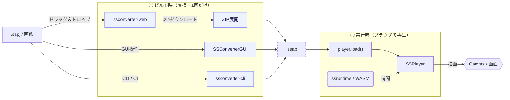

## このドキュメントの読み方

読者を 3 段階に分けて構成しています。**手前だけ読めば目的を達成できる**ように、上から順に踏み込む内容になっています。

[[toc]]

| 読者 | ゴール | 読むところ |
|---|---|---|
| **利用ユーザー** | とにかく動かす | 「はじめに」→「使い方」→「API リファレンス」 |
| **カスタマイズユーザー** | 表現を作り込む | 上記 +「カスタマイズ」 |
| **SDK / Player 開発者** | 内部を拡張・貢献する | 上記 + CONTRIBUTING |

## 概要（.sspj → 描画まで）

`.sspj` は **ビルド時に一度** `.ssab` へ変換し、**実行時**はその `.ssab` を
読み込んで描画するだけです。変換は **ブラウザツール（`ssconverter-web`）**、**GUI ツール（[`SSConverterGUI`](https://github.com/cri-middleware/SSConverterGUI/releases)）** と
**CLI（[`ssconverter-cli`](https://github.com/cri-middleware/SpriteStudio-SDK/releases)）** の 3 経路があります。

図の 3 経路（`SSConverterGUI` / `ssconverter-web` / `ssconverter-cli`）の詳しい使い方は
[アセットの準備](/usage/assets) を参照してください。

## パッケージ

| パッケージ | 用途 |
|---|---|
| [`@spritestudio/ssplayer-pixi`](/usage/pixi) | PixiJS v8 レンダラー（推奨・まずはこれ） |
| [`@spritestudio/ssplayer-webgl`](/usage/webgl) | 軽量な単体 WebGL レンダラー（Web Components `<ss-player>` 含む） |
| [`@spritestudio/ssplayer-rmmz`](/usage/rmmz) | RPG Maker MZ（PixiJS v5, WIP） |
| `@spritestudio/ssplayer-core` | エンジン非依存の WASM コア（レンダラーを自作する場合） |
| [`ssconverter-web`](/usage/assets#ssconverter-web-ブラウザツール) | `.sspj` → `.ssab` 変換ツール（ブラウザ版） |
| [`@spritestudio/ssconverter-core`](/usage/assets#ssconverter-core-ライブラリ-自作アプリへの組み込み) | エンジン非依存の WASM 変換コア（変換を自作アプリに組み込む場合） |
