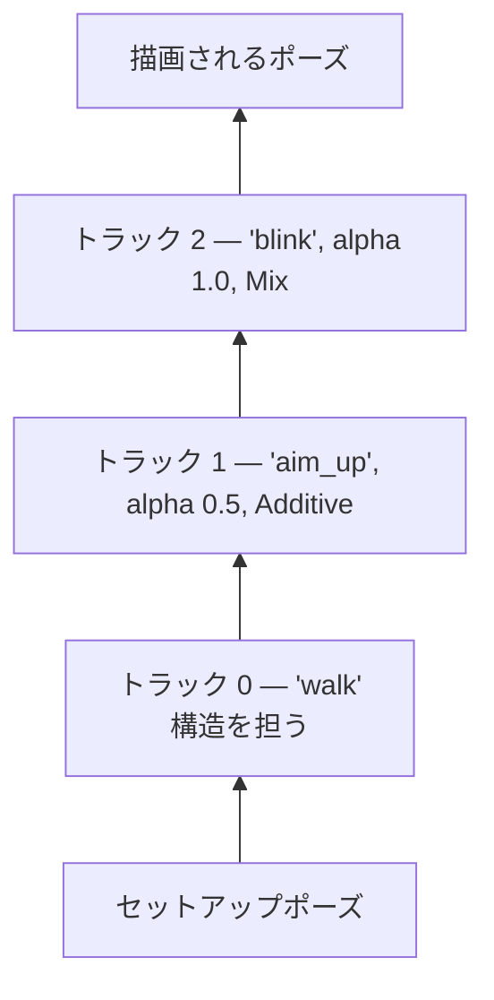

# モーションブレンド

1 体のキャラクターで複数のアニメーションを同時に再生し、カットせずに移り変わります。下地に歩き、その上に照準のオーバーレイ、さらに一回きりのリアクションをクロスフェードで — どれもアーティストが別々のアニメーションとして作ったものです。

以下のメソッドは、PixiJS と WebGL の両パッケージの `SSPlayer` に同じ名前であります。RPG ツクール MZ の `SSPlayer` にもあり、スクリプトから使えます。プラグインコマンドはありません。

## モデル：トラックのスタック

トラックは**セットアップポーズ**の上に、番号の小さい順に重なります。各トラックは、アニメーション・**alpha**（下のポーズにどれだけ重ねるか）・**ブレンド**を持ちます。



**トラック 0 は特別です。** `setAnimation` が確立するのがこれで、構造を担います。セル・表示・パーツカラー・描画順、イベント、再生状態はトラック 0 から来ます。`currentAnimation`・`isFinished`・フレームの読み出し・イベント・`canvasRect` は、すべてトラック 0 のアニメーションに従います。その上のトラックはオーバーレイです。

| ブレンド | 内容 |
|---|---|
| `SSTrackBlend.Mix` | そのトラックのポーズへ近づけます。alpha 1 で完全に上書き |
| `SSTrackBlend.Additive` | **セットアップポーズからの差分**を足すので、下のものが残ります。照準・傾き・呼吸のためのモード |

トラックは、そのアニメーションがキーを打ったアトリビュートにだけ効きます。頭だけにキーを打ったオーバーレイは、マスクを設定しなくても脚には影響しません。オーバーレイが効く範囲は、アーティストがキーを打った範囲そのものです。

## オーバーレイを載せる

```ts
import { SSTrackBlend } from '@spritestudio/ssplayer-pixi'; // または -webgl

player.setAnimation('walk');                  // トラック 0
player.play();

player.setTrackAnimation(1, 'aim_up');        // オーバーレイ
player.setTrackBlend(1, SSTrackBlend.Additive);
player.setTrackAlpha(1, 0.5);                 // 半分の強さ

// ... 外すとき
player.clearTrack(1);
```

`clearTrack` はトラック 0 を受け付けません。代わりに alpha 0 へフェードしてください。キャラクターがセットアップポーズへ収まります。

::: warning トラック 0 を設定するとスタックが作り直されます
`setAnimation` はスタックをトラック 0 だけに戻すので、載せていたオーバーレイも一緒に消えます。ベースのアニメーションを切り替えたら、オーバーレイを載せ直してください。
:::

## カットではなくフェードする

どちらのフェードも、プレーヤー自身の更新で進みます。開始したら、あとは描き続けるだけです。

```ts
// トラックの再生内容を、いまの状態から 400 ms かけて差し替える。
player.crossfade(0, 'run', 400);

// トラックの alpha を 250 ms かけて動かす。
player.fadeTrack(1, 0, 250);   // オーバーレイを抜く
player.fadeTrack(0, 0, 600);   // キャラクター全体をセットアップポーズへ収める

const t = player.getTrackFadeProgress(0); // 0〜1。フェード中でなければ undefined
player.cancelTrackFade(1);
```

### トラック 0 のクロスフェードで何が、いつ替わるか

入ってくるアニメーションは、フェードが終わったときではなく、**フェードを始めたとき**にトラック 0 を引き継ぎます。

- 呼んだ直後から、`currentAnimation` は入ってくる側の名前を返します。そのため、フェードで出ていった名前で `setAnimation` を呼ぶと、何もしないのではなく、そちらへ戻ります。フェード中に入ってくる側の名前を指定した場合は、何もせずフェードが続きます。`canvasRect` もこれに従います。
- セルや表示・非表示など、ブレンドできない値は、フェードの最初のフレームから入ってくる側のものになります。`isFinished` と `onAnimationFinished` が報告するのも入ってくる側の再生状態です。フェード中に出ていく側が終わっても、プレーヤーは終了になりません。
- イベントはフェードの開始から入ってくる側のものが発火し、出ていく側は止まります（[イベント](/ja/customize/events)を参照）。
- 入ってくる側は、`setAnimation` で切り替えたときと同じく、プレーヤーに設定した再生設定（`speedScale`・`frameRate`・`frameSkipEnabled`・方向・`loopCount`）で再生されます。再生区間は、そのアニメーションの全体です。

トラックで再生していたものは、比率を保ったまままとめてフェードアウトします。フェード中にもう一度 `crossfade` すると、進行中のフェードをその時点の状態のまま引き取るので、姿勢は飛びません。`cancelTrackFade` の後や、複数のアニメーションを混ぜているトラックからの `crossfade` でも同じです。

::: tip トラック 0 のクロスフェードはインスタンスの子を作り直しません
それが「切り替え」ではなく「フェード」である理由です。インスタンスパーツとエフェクトパーツは、1 つのアニメーションではなくパックのものなので、どのアニメーションでも子は同じで、動いている子はそのまま続きます。インスタンスとエフェクトの子は、モーションブレンドの対象外です（下の制限を参照）。
:::

## 1 つのトラックで 2 つのアニメーションを混ぜる

1 つのトラックには、複数のアニメーションを載せて **weight** で混ぜられます。キャラクターの移動速度に応じて歩きと走りを混ぜる、といった使い方です。載せた 1 つ 1 つを*ソース*と呼び、ハンドルで指定します。

```ts
player.setAnimation('walk');
player.play();
const walk = player.getTrackMainSource(0)!;
const run = player.addTrackSource(0, 'run', 0); // 歩きの横に、いまは効かない状態で載せる

// 毎フレーム、キャラクターの速度から
player.setSourceWeight(walk, 1 - t);
player.setSourceWeight(run, t);
```

- weight は**トラックの中での比率**です。`(0.7, 0.3)` と `(7, 3)` は同じ混ざり方になります。トラックの強さは、引き続き alpha で決めます。
- 尺の違う歩きと走りは、だんだんずれていきます。トラックの同期を `SSTrackSync.Start` にしてから走りを載せる（次の節）と、歩調をそろえて始められます。または `setSourceFrame` でシークしてください。
- ハンドルは、そのソースが解放されるまで有効です。解放されるのは、クロスフェードの完了、`clearTrack`、`setAnimation` のときで、その後は番号が使い回されるので、持ち続けないでください。

## トラック 0 と歩調をそろえて始める

トラックに載せたアニメーションは、再生区間の先頭から始まります。歩幅の途中にいる歩きの上に走りを載せると、足の運びが食い違います。トラックの**同期**を `SSTrackSync.Start` にすると、そのあと載せたアニメーションは、トラック 0 がいる**位相**から始まります。位相とは、再生区間のどこまで進んだかを、先頭を 0、終端に向かって 1 とした割合で表したものです。尺の違うアニメーションも、割合でそろいます。

```ts
import { SSTrackSync } from '@spritestudio/ssplayer-pixi'; // または -webgl

player.setTrackSync(0, SSTrackSync.Start); // 載せる前に設定する
player.crossfade(0, 'run', 400);           // 走りは歩きと同じ位相から始まる
```

| 同期 | 載せたアニメーションの開始位置 | 向いている使い方 |
|---|---|---|
| `SSTrackSync.Free`（既定） | 再生区間の先頭 | 一回きりの動き（まばたき、口の形、被弾リアクションなど） |
| `SSTrackSync.Start` | トラック 0 のアニメーションと同じ、再生区間の中の割合の位置 | 周期的な動きどうしを重ねる（歩きと走りなど） |

- そのあとトラックに載せるすべての操作に効きます。`setTrackAnimation`・`crossfade`・`addTrackSource` で、トラック 0 でも効きます（入ってくるアニメーションは、出ていくアニメーションの位相から始まります）。
- そろえるのは、アニメーションを載せたときの**1 回だけ**です。その後は両方が 1 つの時計で進むので、尺と速度が同じなら歩調はそろったままです。尺や速度が違えば、またずれていきます。
- alpha や blend と同じく、トラックの設定です。`setAnimation` はすべてのトラックを `Free` に戻します。

## トラックの再生設定

速度・フレームレートの上書き・フレームスキップ・方向は、そこに載っているアニメーションではなく**トラック**の設定です。そのトラックのすべてのアニメーション（クロスフェード中なら両側）と、あとから載せるすべてのアニメーションに効きます。

```ts
import { WebPlaybackDirection, WebPlaybackStyle } from '@spritestudio/ssplayer-pixi'; // または -webgl

player.setTrackSpeed(1, 0.5);
player.setTrackFrameRate(1, 24);
player.setTrackFrameSkipEnabled(1, false);
player.setTrackPlaybackDirection(1, WebPlaybackDirection.Forward, WebPlaybackStyle.PingPong);
```

トラック 0 の設定は、再生設定そのものです（`speedScale` がトラック 0 の `setTrackSpeed`、ほかも同様）。**ループ回数**だけはトラックではなくアニメーションの設定です。アニメーションを載せると無限ループに戻るので、載せた後で指定し、トラックが終わるのを見張ります。トラック 0 のループ回数は `loopCount` で、`setTrackLoopCount(0, …)` も同じ値を書きます。プレーヤーは、トラック 0 が替わるたびにその値をかけ直します。

```ts
player.setTrackAnimation(2, 'hit_react');
player.setTrackLoopCount(2, 1); // 1 回再生して、最後のフレームで止まる

// 毎フレーム
if (player.isTrackFinished(2)) {
  player.fadeTrack(2, 0, 120); // 終わったトラックは、何かするまで最後のフレームのまま
}
```

`trackJustLooped(track)` は更新ごとのパルスで、トラック 0 の `justLooped` にあたります。トラック 1 以降の終了やループを、プレーヤーがリスナーで知らせることはありません。`onAnimationFinished` が発火するのは、トラック 0 の終了だけです。

**トラック 0 が終わっても、キャラクターの時計は止まりません。** その上のトラックとフェードは進み続け、`isFinished` は通常どおり true になります。`stop()` はそのすべてを止めます。

## トラックをスクラブする：連続値の制御

制御軸そのものをアニメーションとして作り（頭が左端から右端まで振り向く、まぶたが開く）、それを*再生しません*。追従したい値で**スクラブ**します。

```ts
player.setTrackAnimation(1, 'look_lr');
player.setTrackBlend(1, SSTrackBlend.Additive);
player.setTrackSpeed(1, 0);               // 自動では進まない
player.setTrackFrame(1, headYawFrame);    // ... あなたが動かす
```

こうすると、ブレンドを毎フレーム分作ることなく、顔がカメラやマウスに追従します。アーティストは両端を作り、アプリケーションがその間の点を選びます。

## 実例の形

ゲーム内キャラクターでよくある 3 トラック構成です。

| トラック | アニメーション | ブレンド | 駆動 |
|---|---|---|---|
| 0 | `idle` / `walk` / `run` | — | 状態が変わったら `crossfade(0, …, 200)` |
| 1 | `aim_lr` | Additive、speed 0 | 照準角から `setTrackFrame` |
| 2 | `hit_react` | Mix | `setTrackAnimation` ＋ `setTrackLoopCount(2, 1)`、`isTrackFinished(2)` になったらフェードアウト |

いま何が載っているかは、`trackCount`・`getTrackAlpha(track)`・`getTrackBlend(track)`・`getTrackSync(track)`・`getTrackFrame(track)`・`getTrackSpeed(track)`・`getTrackLoopCount(track)` などの `getTrack*` の読み出しで確認できます。無いトラックやソースを読むと `undefined` が返り、無いものへの命令は、呼び出しを名指しした `Error` を投げます。

## `<ss-player>` 要素

`el.player` は WebGL の `SSPlayer` なので、上のすべてが使えます。`animation` 属性は、これまでどおり `setAnimation` で切り替えます。クロスフェードの後に書き込むと、いまトラック 0 が再生しているものと比べるので、クロスフェードで出ていった名前を書き戻せば、そちらへ戻ります。

## 制限

- **インスタンスの子はレイヤー化されません。** 別パックのアニメーションを再生するパーツは自分の再生コンテキストで動き、ルートのフレームからスロットで駆動されます。トラックは、あなたが持っているキャラクターに対して働きます。エフェクトパーツも同じで、トラック 0 のクロスフェードをまたいで子をどのキーで動かすかも、対象外です。
- **トラックの alpha が強さです。** 1 つのトラックを複数のアニメーションが共有する場合、ソースの *weight* はそれらの比率を決めるだけで、2 つ目の音量つまみではありません。
- **同じ `.ssab` の中のアニメーションだけ**を積めます。
