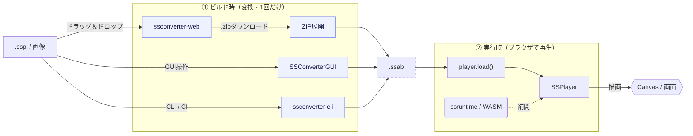

<!-- See the English index.md for why these are relative paths on a raw <a>,
     not markdown links to cri-middleware.github.io. -->

## ブラウザで試す

インストール不要、すべてブラウザ上で動作します（🚧 初回リリースの公開後に有効になります）:

- 🛠️ **<a href="../ssconverter/" target="_blank" rel="noreferrer">ssconverter-web</a>** — `.sspj` → `.ssab` をブラウザ内で変換（まずはここから）
- ▶️ **<a href="../examples/webgl/" target="_blank" rel="noreferrer">単体 WebGL サンプル</a>** — `<ss-player>` Web コンポーネント
- ▶️ **<a href="../examples/pixi/" target="_blank" rel="noreferrer">PixiJS サンプル</a>** — PixiJS v8 アプリ向け
- ▶️ **<a href="../examples/rmmz/" target="_blank" rel="noreferrer">RPG ツクール MZ サンプル</a>** — サンプル MZ プロジェクト
- ▶️ **<a href="../examples/tyranoscript/" target="_blank" rel="noreferrer">TyranoScript サンプル</a>** — ヴィジュアルノベルのシーン
- 🎨 **<a href="../examples/override/" target="_blank" rel="noreferrer">パーツ上書きサンプル</a>** — 実行時の色 / セル / 表示の上書き（PixiJS）
- 📂 **<a href="../examples/sspj-preview/" target="_blank" rel="noreferrer">.sspj を落として再生する</a>** — **手元のプロジェクト**をタブ内で変換して再生・シーク。ユーザーデータ／シグナル／サウンドのキーをタイムライン上に表示。プレイヤーは WebGL と PixiJS を切り替え可能。インストール不要

## 概要（.sspj → 描画まで） {#overview-from-sspj-to-rendering}

`.sspj` は **ビルド時に一度** `.ssab` へ変換し、**実行時**はその `.ssab` を読み込んで描画するだけです。変換は **ブラウザツール（`ssconverter-web`）**、**GUI ツール（[`SSConverterGUI`](https://github.com/cri-middleware/SSConverterGUI/releases)）** と
**CLI（[`ssconverter-cli`](https://github.com/cri-middleware/SpriteStudio-SDK/releases)）** の 3 経路があります。

図の 3 経路（`SSConverterGUI` / `ssconverter-web` / `ssconverter-cli`）の詳しい使い方は
[アセットの準備](/ja/usage/assets) を参照してください。

## パッケージ

| パッケージ | 用途 |
|---|---|
| [`@spritestudio/ssplayer-webgl`](/ja/usage/webgl) | 依存ゼロの単体 WebGL レンダラー（Web Component `<ss-player>` を含む）。フレームワークを使わない構成やドロップイン利用に向いています。 |
| [`@spritestudio/ssplayer-pixi`](/ja/usage/pixi) | すでに **PixiJS v8** で構築したアプリ向けのレンダラーです。 |
| `@spritestudio/ssplayer-core` | エンジン非依存の WASM コア（レンダラーを自作する場合）です。 |
| [`ssconverter-web`](/ja/usage/assets) | `.sspj` → `.ssab` 変換ツール（ブラウザツール + Node CLI）です。 |
| [`@spritestudio/ssconverter-core`](/ja/usage/assets) | エンジン非依存の WASM 変換コア（変換を自作アプリに組み込む場合）です。 |

**ゲームエンジン統合** — `ssplayer-webgl` の上に載る薄いアダプターです（非公開・npm 未公開。プラグインとして導入します）:

| パッケージ | 用途 |
|---|---|
| [`@spritestudio/ssplayer-rmmz`](/ja/usage/rmmz) | **RPG ツクール MZ** 向けレンダラー／プラグインです。 |
| [`@spritestudio/ssplayer-tyranoscript`](/ja/usage/tyrano) | **TyranoScript**（ノベルエンジン）向けプラグインです。 |
| [`@spritestudio/ssplayer-tyranobuilder`](/ja/usage/tyranobuilder) | **ティラノビルダー** 向けプラグインです。同じアニメをコンポーネントパレットから配置でき、変換もエディタ内で行えます。 |

::: tip 旧プレイヤーからの移行をお探しの方へ
旧 **[SS6Player for Web](https://github.com/SpriteStudio/SS6PlayerForWeb)**（`ss6player-pixi`）から移行する場合は、**[SS6Player からの移行](/ja/migration_from_ss6)** で旧→新の API 対応とアセット再変換（`.ssfb` → `.ssab`）の手順を確認してください。
:::

## 関連リポジトリ

- [SpriteStudio Docs](https://cri-middleware.github.io/SpriteStudio-Docs/ja/) — SDK と公式 Player のドキュメントポータル。
- [SpriteStudio-SDK](https://github.com/cri-middleware/SpriteStudio-SDK) — `libssruntime` / `libssconverter` を提供する SDK 本体。
- [SSConverterGUI](https://github.com/cri-middleware/SSConverterGUI) — Player を介さず `.sspj` を変換するデスクトップ GUI。
