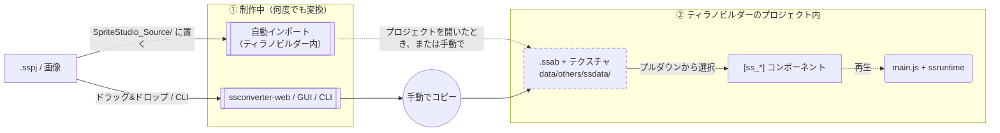

# ティラノビルダーで使う

**SpriteStudio** のアニメを、ティラノビルダーのコンポーネントパレットから配置できます。シナリオを書く必要はありません。SpriteStudio のプロジェクトをゲーム内のフォルダに置いておけば、プロジェクトを開いたときにエディタ側が自動で変換し、以降は指示したときに変換し直します。動作確認は **TyranoBuilder Ver 3.00** で行っています。

シナリオを手書きする場合は [TyranoScript で使う](/ja/usage/tyrano) を参照してください。同じアニメを
`[ss_*]` タグで扱えます。

<!-- Relative path on a raw <a target="_blank">, not a markdown link -- see
     docs/index.md for why. -->

▶️ **<a href="../../examples/tyranoscript/" target="_blank" rel="noreferrer">ライブデモ</a>** —
TyranoScript 版のサンプルシーンです。ランタイムは同じなのでビルダー専用のデモはありません。コンポーネントで配置した結果もここと同じ見た目になります。

## 1. インストール

::: tip どれをダウンロードすればよい？
必要なのは `ssplayer.tbp` だけです。TyranoScript 用プラグイン ZIP の中身はすべて含まれているため、**あの ZIP を重ねて入れないでください。** 展開先はどちらも `data/others/plugin/ssplayer/` で、両方入れるとエディタ側とランタイム側でバージョンがずれます。
:::

1. [GitHub Releases](https://github.com/cri-middleware/SSPlayerForWeb/releases?q=ssplayer-tyranobuilder&expanded=true) から `ssplayer.tbp` をダウンロードします。`@spritestudio/ssplayer-tyranobuilder <version>` という名前の Release を開き、**Assets** にあるファイルを取ってください（*Source code* のアーカイブではありません）。
2. ティラノビルダーでメニューの **プロジェクト → プラグイン** を開き、**プラグインを追加** でそのファイルを選びます。

**ファイル名は変えないでください。** ティラノビルダーはファイル名からプラグイン id を決め、その id でアーカイブ内の `<id>/<id>.builder.js` を探します。`ssplayer-1.2.0.tbp` にすると何もインストールされません。バージョンはファイル名ではなくリリース側で管理します。

これ以外の準備は不要です。プラグイン読み込みのタグも、ランタイムの初期化も要りません。

## 自動インポート {#the-auto-importer}

`.sspj` は編集用の SpriteStudio プロジェクト、`.ssab` はゲームが実際に再生する軽量なランタイムファイルです。このプラグインは、ゲームのフォルダに置いた SpriteStudio のプロジェクトを、エディタの中で `.ssab` に変換します。



自動変換したものも手動で入れたものも置き場所は同じで、コンポーネントのプルダウンには両方が並びます（[自分で変換した .ssab を使う](#bringing-in-a-pack-you-converted-yourself)を参照）。

### 基本の使い方

1. SpriteStudio のプロジェクトを、**`.sspj` とそのフォルダ一式**（アニメは複数ファイルで構成されるため）でプロジェクトフォルダ内の **`SpriteStudio_Source/`** に置きます。このフォルダは初回起動時にプラグインが作成するので、すでに用意されています。
2. ティラノビルダーでプロジェクトを開きます。
3. 変換の結果がメッセージで表示されます。アニメは **SpriteStudio 表示** コンポーネントのプルダウンから選べる状態になっています。変換に失敗したときは、理由がダイアログで表示されます。

`.sspj` ごとに、その名前のフォルダが `data/others/ssdata/` 以下に作られます。

```
SpriteStudio_Source/Ringo/Ringo.sspj   →   data/others/ssdata/Ringo/Ringo.ssab
                                                                 （+ テクスチャ）
```

サブフォルダも検索対象なので、ソースの整理は好きな形で構いません。出力フォルダ名は `.sspj` のファイル名だけで決まります。

### 変更を取り込む

変換が走るのは**プロジェクトを開いたとき**で、それ以降は指示したときだけです。エディタを開いている間、裏で変換が走ることはありません。SpriteStudio で保存したあとの戻り道は 2 つあります。

| | 場所 | 動作 |
| --- | --- | --- |
| **今すぐ再変換** | そのアニメを再生している **SpriteStudio 表示** コンポーネント | 記録に関わらず、そのアニメデータ 1 つを変換し直す |
| **今すぐ取り込む** | **プロジェクト → プラグイン** → **SpriteStudio** | プロジェクトを開いた後に追加・編集されたものをすべて変換する |

普段使うのは **今すぐ再変換** です。**今すぐ取り込む** は、プロジェクトを開いたまま `SpriteStudio_Source/` に**新しく**置いたプロジェクトのためのものです。まだどのコンポーネントからも指定できないので、こちらで変換します。

同じ画面に **SpriteStudio_Source を開く** と **変換ログを開く** があり、動いているコンバータのバージョン（`converter <version> (ssab v1, ssqb v1)`）も表示されます。不具合を報告するときは、この行を添えてください。

### 「変更された」の判定

プロジェクトを開いたときは、プロジェクトごとに**そのフォルダ内で最も新しい更新時刻**（`.sspj` / `.ssae` / `.ssce` / テクスチャなど、すべて）を、**成功した**最後の変換と比べ、ソースの方が新しいものだけを変換し直します。プラグインを更新したときは、ソースが変わっていないものも作り直します。出力フォルダ（`data/others/ssdata/Ringo/` など）が無くなっていれば、それも作り直します。

変換し直すと、前回書き出して今回は書き出さなかったファイルを削除します。SpriteStudio 側でアニメを削除すれば、プルダウンからも消え、書き出したゲームにも入らなくなります。自分で置いたファイルはそのまま残ります。

この記録はプロジェクト直下の `.ss_import_state.json` です。すべて作り直したいときは、このファイル（または出力フォルダ）を削除してプロジェクトを開き直してください。

### 自分で変換した .ssab を使う {#bringing-in-a-pack-you-converted-yourself}

**アニメデータ**のプルダウンには、**`data/` 以下のすべての `.ssab`** が並びます（自動変換したものが先、残りはアルファベット順）。

[`ssconverter-web` / SSConverter GUI / `ssconverter-cli`](/ja/usage/assets) で変換して手動でコピーしたデータも、同じように選べます。シーンの画像の隣に置くなど、プロジェクトの都合で構いません。**アニメーション**のプルダウンは `.ssab` そのものから読むので、手動で入れたデータでも正確です。

自動で同期されるのは `SpriteStudio_Source/` に置いたものだけです。ただし `data/others/ssdata/` から**コピーした**データなら **今すぐ再変換** が使え、生成元のフォルダではなく今ある場所へ書き直します。まったく別の場所で変換したデータには変換元のプロジェクトがないため、その旨を表示します。

### 生成されるファイルの置き場所

| パス | 内容 | 書き出したゲームに含まれる？ |
| --- | --- | --- |
| `SpriteStudio_Source/` | 入力となる `.sspj` プロジェクト | 含まれない |
| `data/others/ssdata/<名前>/` | 変換後の `.ssab` + テクスチャ | **含まれる**（ゲームが再生するデータ） |
| `.ss_import_state.json` | 成功した最後の変換の記録と、各フォルダの変換元 `.sspj` | 含まれない |
| `ss_import_log.txt` | 変換の記録と失敗理由 | 含まれない |
| `.ss_tools/ssconverter_bg.wasm` | プラグインのフォルダから移したコンバータ本体 | 含まれない |

書き出したゲームには `data/` 以下がすべて入るので、制作時のファイルは `data/` の外に置いています。

### ログを読む

エディタにはコンソールが無いので、変換の記録はプロジェクト直下の **`ss_import_log.txt`** に 1 行ずつ書き込まれます。セッションをまたいで追記されます（256 KB を超えると書き直します）。

```
2026-07-29T04:15:02.118Z  --- session start ---
2026-07-29T04:15:02.140Z  sources: /Users/you/TyranoBuilder/mygame/SpriteStudio_Source
2026-07-29T04:15:02.141Z  output:   /Users/you/TyranoBuilder/mygame/data/others/ssdata
2026-07-29T04:15:02.150Z  converter: worker — converter 7.0.0-beta.1+427024d (ssab v1, ssqb v1)
2026-07-29T04:15:02.219Z  converted Ringo: 14 in -> 2 out (+1 textures) in 78ms -> …/ssdata/Ringo
2026-07-29T04:15:02.220Z  first pass: 1 converted, 0 up to date, 0 failed, 0 dropped
```

`converter:` の行が `inline` のときは、変換のあいだエディタの操作が止まります。理由は同じ行に出ます。

起動時に検出したホスト環境も記録されるので、プラグインが動いていないように見えるときは、まずここを見てください。

### 現在の制限

- **フォルダは固定です。** `SpriteStudio_Source/` と `data/others/ssdata/` は変更できません。
- **テクスチャは埋め込みではなくコピーです。** 各データは画像を `.ssab` の兄弟ファイルとして持ちます。手動で移動するときは一緒に移動してください。
- **拾うのは `.sspj` だけです。** `SpriteStudio_Source/` 内のそれ以外のファイルは対象になりません（プロジェクトが変更されたかどうかの判定では、フォルダ内の一部として参照されます）。

## コンポーネント {#the-components}

パレットの **プラグイン** の下にあります。

| | |
| --- | --- |
| **SpriteStudio 表示** | アニメを読み込んでレイヤーに表示 |
| **SpriteStudio フェードイン / フェードアウト** | 表示・非表示 |
| **SpriteStudio アニメ変更** | 同じデータ内の別アニメーションに切り替え |
| **SpriteStudio 停止 / 一時停止 / 再開** | 再生の制御 |
| **SpriteStudio 音声停止** | アニメが鳴らした音を止める |
| **SpriteStudio 待機** | アニメが終わるまでストーリーを止める |
| **SpriteStudio シグナル待機** | 攻撃が当たった瞬間など、アニメがシグナルを出すまでストーリーを止める |
| **SpriteStudio 再生速度 / フレーム移動** | 再生速度を変える / 指定フレームへ移動 |
| **SpriteStudio 区間再生 / 再生方向** | 指定範囲だけをループ / 順・逆・往復 |
| **SpriteStudio 話者連動** | キャラクターの台詞が表示されている間だけトークアニメを再生 |
| **SpriteStudio パーツの色 / パーツの表示 / パーツの画像** | パーツ 1 つの色・表示・描くセルを変える |
| **SpriteStudio パーツの変更を解除** | パーツの変更を元に戻す |
| **SpriteStudio 位置変更 / 移動** | 即座に配置、または時間をかけて移動 |
| **SpriteStudio 削除 / 全削除** | 1 つ、またはすべて破棄 |
| **SpriteStudio 全体フェードアウト / 全体フェードイン** | 場面転換用にまとめて |
| **SpriteStudio 全体一時停止 / 全体再開** | メニュー画面用にまとめて |
| **SpriteStudio 音声設定** | 既定と違う鳴らし方にしたいときだけ |

コンポーネント名はティラノビルダー自身の言語に従います（`<TyranoBuilder>/lang/lang.txt` で決まります）。英語のエディタでは "SpriteStudio: show" のように表示されます。

各項目について、知っておくと役に立つ点は次のとおりです。

- **管理名** は他のコンポーネントがアニメを指定するための名前です。「表示」で決め、以降はそのシーンに置かれている名前のプルダウンになります。
- **アニメデータ** はプロジェクト内のすべての `.ssab`（自動変換・手動コピーを問わず）が並びます。
- **アニメーション** は選択中のデータに実際に含まれるものが並びます（`.ssab` から読み取ります）。
- **次に再生** は再生終了後に別のアニメーションへ引き継ぎます（登場アニメから待機ループへ、など）。「ループ再生する」をオフにする必要があります。ループするアニメは終わらないためです。
- **パーツ**・**セルマップ**・**セル** は、その管理名のアニメデータに含まれるものが並びます。**パーツ**には変更できるものだけが出ます（色は通常パーツ、画像は通常パーツとマスクパーツ）。

各コンポーネントは対応する `[ss_*]` タグをそのまま書き出すので、動作は
[タグ一覧](/ja/usage/tyrano#_4-tags) の説明どおりです。

## うまくいかないとき {#troubleshooting}

変換に失敗した場合は、その理由が画面に表示されます。同じ内容は、成功した変換の記録とともにプロジェクト直下の `ss_import_log.txt` に残ります。このファイルはプラグイン画面から開けます。

プレビュー中にコンポーネントが役目を果たせないとき（「表示」で作っていない管理名や、アニメデータに無くなったアニメーションを指定したときなど）は、その理由がシーンのファイル名と行番号付きのダイアログで表示されます。書き出したゲームでは表示されません。書き出し時にエンジンのデバッグ設定がオフになるためです。

- **アニメがプルダウンに出ない** — `.sspj` がフォルダ一式で `SpriteStudio_Source/` に入っているかを確認し、ログに `FAILED` の行がないか見てください。
- **パレットに SpriteStudio のコンポーネントが無い** — プラグインが読み込まれていません。`.tbp` を入れ直し、スタンダード版のプラグイン 2 個制限を超えていないか確認してください。
- **変換はできたのにゲームに出ない** — 「表示」がそれを参照するコンポーネントより前にあるか、レイヤー番号がゲームで使っているものかを確認してください。
- **2 つのうち片方がいつまでも変換されない** — 同じファイル名の `.sspj` は同じ
  `data/others/ssdata/<名前>/` に変換されるため、先に見つかった方だけを変換し、ぶつかった 2 つの名前を表示します。どちらかの名前を変えてください。
- **SpriteStudio での変更が反映されない** — プロジェクトを開いたあとは自動では走りません。コンポーネントの **今すぐ再変換** を使ってください。まだコンポーネントが無いプロジェクトはプラグイン画面の **今すぐ取り込む** です。どちらでも反映されない場合は
  `.ss_import_state.json` を削除してプロジェクトを開き直してください。

