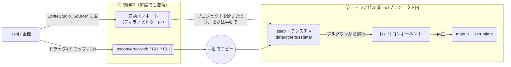

# ティラノビルダーで使う

::: warning ベータ版
`@spritestudio/ssplayer-tyranobuilder` は **ベータ版**（`7.0.0-beta.1`）です。コンポーネント構成や
フォルダ構成は `7.0.0` までに変わる可能性があります。動作確認は **TyranoBuilder Ver 3.00**
（Electron 24.8.8）の macOS で行っています。Windows は未検証です。

**リリースはまだ 1 つもありません。** 正式リリース後は `ssplayer.tbp` が **GitHub Releases** で
配布される予定です。現時点では [ソースからビルド](#ソースからビルドする)してください。
:::

**SpriteStudio 7** のアニメを、ティラノビルダーのコンポーネントパレットから配置できます。
シナリオを書く必要はありません。SpriteStudio のプロジェクトをゲーム内のフォルダに置いておけば、
保存するたびにエディタ側が自動で変換します。作業を続けたままで構いません。

シナリオを手書きする場合は [TyranoScript で使う](/ja/usage/tyrano) を参照してください。同じアニメを
`[ss_*]` タグで扱えます。

<!-- Relative path on a raw <a target="_blank">, not a markdown link -- see
     docs/index.md for why. -->

▶️ **<a href="../../examples/tyranoscript/" target="_blank" rel="noreferrer">ライブデモ</a>** —
TyranoScript 版のサンプルシーンです。ランタイムは同じなのでビルダー専用のデモはありません。コンポーネントで配置した結果もここと同じ見た目になります（最初のリリース公開後に有効化されます 🚧）。

## プラグインの構成

`ssplayer.tbp` は、両方の役割を持つ 1 つのプラグインフォルダをインストールします。

| | ファイル | 役割 |
| --- | --- | --- |
| **エディタ側** | `ssplayer.builder.js` | [自動インポート](#自動インポート)と、パレットの [SpriteStudio コンポーネント](#コンポーネント) |
| **ランタイム側** | `main.js` + `ssruntime_bg.wasm` | コンポーネントが書き出す `[ss_*]` タグの登録と、アニメの描画 |

ランタイム側は [`@spritestudio/ssplayer-tyranoscript`](/ja/usage/tyrano) そのもので、手書きシナリオで
使うバンドルと同一です。1 つのフォルダに両方を同梱しているため、**プラグインの数は 1 つ**で済みます。
無料版はプラグインを 2 つまでしか読み込まないため、この点は重要です。

エディタ側はプロジェクトを開いたときに動きます。ビルダーがプロジェクト内の
`<id>/<id>.builder.js` を見つけて構築する、これがインポーターとパレット登録のフックです。あわせて
`data/scenario/system/plugin_third.ks`（ビルダーが読み込みのたびに再生成します）に
`[plugin name="ssplayer"]` を追加するので、ゲーム側でランタイムを読み込む記述は不要です。

## 1. インストール

::: tip どれをダウンロードすればよい？
必要なのは `ssplayer.tbp` だけです。TyranoScript 用プラグイン ZIP の中身はすべて含まれているため、
**あの ZIP を重ねて入れないでください。** 展開先はどちらも `data/others/plugin/ssplayer/` で、
両方入れるとエディタ側とランタイム側でバージョンがずれます。
:::

1. [Releases](https://github.com/cri-middleware/SSPlayerForWeb/releases) から `ssplayer.tbp` を
   ダウンロードします。
2. ティラノビルダーで **プラグイン設定 → 追加 → そのファイルを選択**。

**ファイル名は変えないでください。** ティラノビルダーはファイル名からプラグイン id を決め、その id で
アーカイブ内の `<id>/<id>.builder.js` を探します。`ssplayer-1.2.0.tbp` にすると何もインストール
されません。バージョンはファイル名ではなくリリース側で管理します。

これ以外の準備は不要です。プラグイン読み込みのタグも、ランタイムの初期化も要りません。

## 自動インポート

`.sspj` は編集用の SpriteStudio プロジェクト、`.ssab` はゲームが実際に再生する軽量なランタイム
ファイルです。この変換はどの統合でもどこかで行う必要があり、[単体のツール](/ja/usage/assets)では
手動で行います。このプラグインはそれをエディタ内で、ソースが変わるたびに自動で行います。



自動変換したものも手動で入れたものも置き場所は同じで、コンポーネントのプルダウンには両方が
並びます（後述の「自分で変換した .ssab を使う」を参照）。

### 基本の使い方

1. SpriteStudio のプロジェクトを、**`.sspj` とそのフォルダ一式**（アニメは複数ファイルで構成される
   ため）でプロジェクトフォルダ内の **`SpriteStudio_Source/`** に置きます。このフォルダは初回起動時に
   プラグインが作成するので、すでに用意されています。
2. ティラノビルダーでプロジェクトを開きます。
3. 変換結果がトーストで表示されます。アニメは **SpriteStudio 表示** コンポーネントのプルダウンから
   選べる状態になっています。

`.sspj` ごとに、その名前のフォルダが `data/others/ssdata/` 以下に作られます。

```
SpriteStudio_Source/Ringo/Ringo.sspj   →   data/others/ssdata/Ringo/Ringo.ssab
                                                                 （+ テクスチャ）
```

サブフォルダも検索対象なので、ソースの整理は好きな形で構いません。ツリー全体から `.sspj` を探し、
出力フォルダ名は `.sspj` のファイル名だけで決まります。

### 変更を取り込む

変換が走るのは**プロジェクトを開いたとき**で、それ以降は指示したときだけです。バックグラウンドでの
監視は行いません。1 回のチェックはソースファイル 1 つにつき 1 回の `stat` で、そのすべてがエディタを
描画しているスレッド上の Electron contextBridge 越しの同期呼び出しになる一方、得るものが無いためです
（保存した瞬間、作業者はトーストではなく SpriteStudio を見ています）。これは
[SpriteStudio Player for Ren'Py](https://github.com/cri-middleware/SSPlayerForRenPy)（起動時に変換し、
取り込みには `Shift + R` が必要）や
[SpriteStudio Player for Godot](https://github.com/cri-middleware/SSPlayerForGodot)（インスペクタの
ボタンのみで、鮮度チェック自体が無い）と同じ形です。

そのため SpriteStudio で保存したあとの戻り道は 2 つあります。

| | 場所 | 動作 |
| --- | --- | --- |
| **今すぐ再変換** | そのアニメを再生している **SpriteStudio 表示** コンポーネント | 記録に関わらず、そのアニメデータ 1 つを変換し直す |
| **今すぐ取り込む** | プラグイン管理（**プラグイン** メニュー）→ **SpriteStudio** | プロジェクトを開いた後に追加・編集されたものをすべて変換する |

普段使うのは **今すぐ再変換** です。対象を 1 つに絞って強制的に変換します（押した時点で、作業者は
そのデータが古いと判断済みだからです）。**今すぐ取り込む** は `.sspj` が**新規**のときのためのものです。
コンポーネントは既に存在するデータしか指定できないため、プロジェクトを開いたまま
`SpriteStudio_Source/` に置いたプロジェクトには押す場所がありません。プラグイン管理のパネルは
シナリオ上のどれにも紐づかない場所で、ボタンがそこにあるのはそのためです。

::: tip 通知の出し方について
再変換が終わるのは、エディタではなく SpriteStudio で作業している最中であることが多いため、モーダルでは
なく**トースト**で通知します。作業中のアプリからフォーカスを奪わないためです。モーダルを出す唯一の
ケースは `SpriteStudio_Source/` に `.sspj` が 1 つもないときで、初めて使う人にプロジェクトの置き場所を
伝えるためです。
:::

::: tip 変換中もエディタは描画を続けます
コンバータは WebAssembly で、その呼び出しは同期的です。そのため以前は変換のあいだエディタが固まって
いました（サンプル 20 個のフォルダで 1.2 秒、うち 1 プロジェクトだけで 0.64 秒）。現在は Worker 上で
動くため、同じフォルダでの最長停止は 50 ms を下回ります。ファイルの読み書きは今もエディタのスレッド上
です。プラグインからファイルシステムに届く経路がレンダラー限定のブリッジしかないためで、残っているのは
その部分です。
:::

### 「変更された」の判定

各パスでは、プロジェクトごとに**そのフォルダ内で最も新しい更新時刻**（`.sspj` / `.ssae` / `.ssce` /
テクスチャなど、すべて）と、**成功した**最後のインポートが対象にした時刻を比較します。ソースの方が
新しければ再変換し、そうでなければスキップします（数回の `stat` で済みます）。

その記録は、プロジェクト直下の小さな JSON ファイル `.ss_import_state.json` です。

```json
{
  "packs": {
    "Ringo": { "source_mtime": 1753142400000, "converter": "…" }
  }
}
```

再変換のタイミングを決めているのは、次の 2 点です。

- **判断材料は出力ファイルの時刻ではなく、この状態ファイルです。** 途中で失敗した変換も、新しく
  見える出力を残します。つまり出力の時刻からは成功したかどうかが分かりません。**成功後**に書かれた
  記録があってはじめて、次回スキップしてよいと判断できます。
- **出力が無ければ、状態が最新でも再変換します。** `data/others/ssdata/Ringo/` を削除すれば、次の
  パスで作り直されます。

すべて作り直したいときは、`.ss_import_state.json`（または出力フォルダ）を削除してプロジェクトを
開き直してください。

### 自分で変換した .ssab を使う

インポーターが管理するのは `SpriteStudio_Source/` → `data/others/ssdata/` の範囲だけで、
**アニメデータ**のプルダウンはその範囲に限りません。プルダウンには **`data/` 以下のすべての
`.ssab`** が並びます（自動変換したものが先、残りはアルファベット順）。

[`ssconverter-web` / `SSConverterGUI` / `ssconverter-cli`](/ja/usage/assets) で変換して手動でコピー
したデータも、同じように選べます。シーンの画像の隣に置くなど、プロジェクトの都合で構いません。
**アニメーション**のプルダウンは `.ssab` そのものから読むので、手動で入れたデータでも正確です。

自動で同期されるのは `SpriteStudio_Source/` に置いたものだけです。手動でコピーしたデータの更新は
自分で行ってください。

### 生成されるファイルの置き場所

| パス | 内容 | 書き出したゲームに含まれる？ |
| --- | --- | --- |
| `SpriteStudio_Source/` | 入力となる `.sspj` プロジェクト | 含まれない |
| `data/others/ssdata/<名前>/` | 変換後の `.ssab` + テクスチャ | **含まれる**（ゲームが再生するデータ） |
| `.ss_import_state.json` | 成功した最後のインポートの記録 | 含まれない |
| `ss_import_log.txt` | インポーターの動作ログと失敗理由 | 含まれない |
| `.ss_tools/ssconverter_bg.wasm` | プラグインフォルダから退避したコンバータ本体 | 含まれない |

ティラノビルダーの書き出しは `index.html` / `data/` / `tyrano/` を無条件にコピーする 3 つの処理なので、
**`data/` 以下に置いたものはすべて、書き出したゲームに同梱されます。** 上記の制作時ファイルを
`data/` の外に置いているのはそのためです。1.4 MB のコンバータを初回起動時に `.ss_tools/` へ移動して
いるのも同じ理由です。`.tbp` はプラグインフォルダ（`data/` の下）にしかファイルを配置できませんが、
コンバータを読むのはエディタ側だけなので、そこに置いておく必要はありません。

### ログを読む

ティラノビルダーのメインウィンドウはメニューバー無し・DevTools のショートカット無しで作られている
ため、`console.log` は制作者からはほぼ見えません。そこでインポーターの出力は 1 行ずつ、プロジェクト
直下の **`ss_import_log.txt`** にも書き込まれます。都度フラッシュされ、セッションをまたいで追記され
ます（256 KB を超えると書き直します）。

```
2026-07-29T04:15:02.118Z  --- session start ---
2026-07-29T04:15:02.140Z  sources: /Users/you/TyranoBuilder/mygame/SpriteStudio_Source
2026-07-29T04:15:02.141Z  output:   /Users/you/TyranoBuilder/mygame/data/others/ssdata
2026-07-29T04:15:02.150Z  converter: worker (7.0.0-beta.1+427024d)
2026-07-29T04:15:02.219Z  converted Ringo: 14 in -> 2 out (+1 textures) in 78ms -> …/ssdata/Ringo
2026-07-29T04:15:02.220Z  first pass: 1 converted, 0 up to date, 0 failed
```

`converter:` の行は wasm がどこで動いたかを示します。通常は `worker` です。`inline` の場合は Worker を
起動できなかったことを意味し、理由が同じ行に出力され、変換は従来どおり UI を止めます。

起動時に検出したホスト環境も記録されるので、プラグインが動いていないように見えるときは、まずここを
見てください。

### 現在の制限

- **ファイルの読み書きは今もエディタのスレッド上です。** 変換自体は Worker で動きますが、プラグインが
  ファイルシステムに触れる経路はレンダラー限定のブリッジしかないため、各プロジェクトの入出力は移せま
  せん。サンプル 20 個のフォルダで、以前はパス全体で 1.2 秒固まっていたところが、50 ms 未満の停止に
  収まります。
- **フォルダは固定です。** `SpriteStudio_Source/` と `data/others/ssdata/` は変更できません
  （Ren'Py 版のインポーターには上書き指定がありますが、こちらにはまだありません）。
- **テクスチャは埋め込みではなくコピーです。** 各データは画像を `.ssab` の兄弟ファイルとして持ちます。
  手動で移動するときは一緒に移動してください。
- **拾うのは `.sspj` だけです。** `SpriteStudio_Source/` 内のそれ以外のファイルは対象になりません
  （プロジェクトが変更されたかどうかの判定では、フォルダ内の一部として参照されます）。

## コンポーネント

パレットの **プラグイン** の下にあります。

| | |
| --- | --- |
| **SpriteStudio 表示** | アニメを読み込んでレイヤーに表示 |
| **SpriteStudio フェードイン / フェードアウト** | 表示・非表示 |
| **SpriteStudio アニメ変更** | 同じデータ内の別アニメーションに切り替え |
| **SpriteStudio 停止 / 一時停止 / 再開** | 再生の制御 |
| **SpriteStudio 待機** | アニメが終わるまでストーリーを止める |
| **SpriteStudio 位置変更 / 移動** | 即座に配置、または時間をかけて移動 |
| **SpriteStudio 削除 / 全削除** | 1 つ、またはすべて破棄 |
| **SpriteStudio 全体フェードアウト / 全体フェードイン** | 場面転換用にまとめて |
| **SpriteStudio 全体一時停止 / 全体再開** | メニュー画面用にまとめて |
| **SpriteStudio 音声設定** | 既定と違う鳴らし方にしたいときだけ |

コンポーネント名はティラノビルダーの言語設定に従うので、英語のエディタでは "SpriteStudio: show" の
ように表示されます。

各項目について、知っておくと役に立つ点は次のとおりです。

- **管理名** は他のコンポーネントがアニメを指定するための名前です。「表示」で決め、以降は
  そのシーンに置かれている名前のプルダウンになります。
- **アニメデータ** はプロジェクト内のすべての `.ssab`（自動変換・手動コピーを問わず）が並びます。
- **アニメーション** は選択中のデータに実際に含まれるものが並びます（`.ssab` から読み取ります）。
- **次に再生** は再生終了後に別のアニメーションへ引き継ぎます（登場アニメから待機ループへ、など）。
  「ループ再生する」をオフにする必要があります。ループするアニメは終わらないためです。

各コンポーネントは対応する `[ss_*]` タグをそのまま書き出すので、動作は
[タグ一覧](/ja/usage/tyrano#_4-提供タグ) の説明どおりです。

::: warning コンポーネントが無いタグもあります
パーツ単位の色・表示切り替え（`[ss_part_*]`）と、話者との連動（`[ss_chara]`）にはパレット項目が
ありません。これらはティラノビルダーの「ティラノスクリプト」コンポーネントで
[`[ss_*]` タグ](/ja/usage/tyrano#_4-提供タグ)を直接記述してください。
:::

## うまくいかないとき

まずプロジェクト直下の `ss_import_log.txt` を確認してください。すべての変換が、失敗時はその理由と
ともに記録されています。

- **アニメがプルダウンに出ない** — `.sspj` がフォルダ一式で `SpriteStudio_Source/` に入っているかを
  確認し、ログに `FAILED` の行がないか見てください。
- **パレットに SpriteStudio のコンポーネントが無い** — プラグインが読み込まれていません。`.tbp` を
  入れ直し、無料版のプラグイン 2 個制限を超えていないか確認してください。
- **変換はできたのにゲームに出ない** — 「表示」がそれを参照するコンポーネントより前にあるか、
  レイヤー番号がゲームで使っているものかを確認してください。
- **SpriteStudio での変更が反映されない** — プロジェクトを開いたあとは自動では走りません。
  コンポーネントの **今すぐ再変換** を使ってください。まだコンポーネントが無いプロジェクトは
  プラグイン管理の **今すぐ取り込む** です。どちらでも反映されない場合は
  `.ss_import_state.json` を削除してプロジェクトを開き直してください。

## ソースからビルドする

```sh
pnpm --filter @spritestudio/ssplayer-tyranoscript  run build   # ランタイム側
pnpm --filter @spritestudio/ssplayer-tyranobuilder run build
pnpm --filter @spritestudio/ssplayer-tyranobuilder run pack    # → dist/pack/ssplayer.tbp
```

ビルドのたびにインストールダイアログを通すのは手間なので、プロジェクトへ直接インストールできます。

```sh
node packages/ssplayer-tyranobuilder/scripts/install.mjs mygame --sample
```

`~/TyranoBuilder/myproject` 以下のプロジェクト名を指定するか、任意の場所のパスを渡します。名前を
省略すると、プロジェクトが 1 つならそれを使い、複数あれば一覧を表示します。`--sample` は SDK
サブモジュールから `SpriteStudio_Source/Ringo/` を用意するので、初回から変換対象があります。あとは
プロジェクトを開く（または開き直す）だけです。
