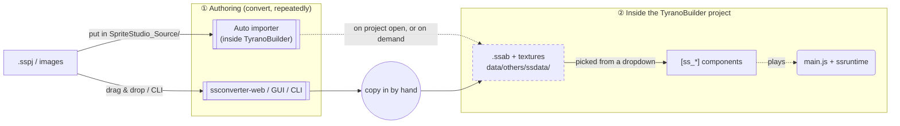

# TyranoBuilder

::: warning Beta
`@spritestudio/ssplayer-tyranobuilder` is in **beta** (`7.0.0-beta.1`). The component set and
the folder layout may still change before `7.0.0`. Verified on **TyranoBuilder Ver 3.00**
(Electron 24.8.8) on macOS; Windows is untested.

**There are no releases yet.** Once the first release ships, `ssplayer.tbp` will be
distributed on **GitHub Releases** — for now, [build it from source](#building-from-source).
:::

Place **SpriteStudio** animations from TyranoBuilder's component palette, with no scenario
code to write. Drop a SpriteStudio project into a folder in your game and the editor converts
it for you — when the project opens, and again whenever you ask.

Writing scenarios by hand instead? See [TyranoScript](/usage/tyrano), which gives you the same
animations as `[ss_*]` tags.

<!-- Relative path on a raw <a target="_blank">, not a markdown link -- see
     docs/index.md for why. -->

▶️ **<a href="../examples/tyranoscript/" target="_blank" rel="noreferrer">Live demo</a>** — the
TyranoScript sample scene. There is no separate Builder demo because it is the same runtime:
what the components place is what you see here (goes live once the first release is published 🚧).

## One plugin, two halves

`ssplayer.tbp` installs a single plugin folder holding both sides of the integration:

| | File | What it does |
| --- | --- | --- |
| **Editor half** | `ssplayer.builder.js` | The [auto importer](#the-auto-importer) and the SpriteStudio [components](#the-components) in the palette |
| **Runtime half** | `main.js` + `ssruntime_bg.wasm` | Registers the `[ss_*]` tags the components write, and renders the animations |

The runtime half is [`@spritestudio/ssplayer-tyranoscript`](/usage/tyrano) — the same bundle
hand-written scenarios use. Shipping both in one folder keeps this to **one plugin**, which
matters because TyranoBuilder's free version loads at most two.

The editor half runs when a project is opened: the builder finds
`<id>/<id>.builder.js` in the project and constructs it. That is the hook the importer and the
palette entries hang off. It also contributes `[plugin name="ssplayer"]` to
`data/scenario/system/plugin_third.ks` (which the builder regenerates on every load), so your
game boots the runtime with nothing for you to write.

## 1. Install

::: tip Which download do I need?
`ssplayer.tbp` is the only one. It already contains the TyranoScript plugin ZIP's contents plus
the editor half, so **do not also install that ZIP** — both unpack to
`data/others/plugin/ssplayer/`, and stacking them leaves the two halves on different versions.
:::

1. Download `ssplayer.tbp` from
   [Releases](https://github.com/cri-middleware/SSPlayerForWeb/releases).
2. In TyranoBuilder: **plugin settings → add → pick that file**.

**Do not rename the file.** TyranoBuilder derives the plugin's id from the filename and then
looks for `<id>/<id>.builder.js` inside the archive, so `ssplayer-1.2.0.tbp` would install
nothing. The version lives in the release, not in the filename.

Nothing else to set up — no plugin tag to write, no runtime to initialise.

## The auto importer

`.sspj` is your editable SpriteStudio project; `.ssab` is the compact runtime file the game
actually plays. Every integration needs that conversion to happen somewhere — the
[standalone tools](/usage/assets) do it by hand, and this plugin does it inside the editor, for
you, whenever the sources change.



The imported route and the manual route land in the same place, and the component dropdowns
list both — see [Bringing in a pack you converted yourself](#bringing-in-a-pack-you-converted-yourself).

### Basic use

1. Put your SpriteStudio project — the `.sspj` **and the rest of its folder**, since an
   animation is several files — into **`SpriteStudio_Source/`** in your project folder. The
   plugin creates that folder on first run, so it is already there waiting.
2. Open the project in TyranoBuilder.
3. A toast tells you what was converted. The animation is now in the **SpriteStudio: show**
   component's dropdowns.

Each `.sspj` becomes a folder named after it, under `data/others/ssdata/`:

```
SpriteStudio_Source/Ringo/Ringo.sspj   →   data/others/ssdata/Ringo/Ringo.ssab
                                                                 (+ its textures)
```

Subfolders are searched too, so you can group sources however you like — the whole tree is
walked for `.sspj` files, and only the file name of the `.sspj` itself decides the output
name.

### Picking up a change

A pass runs **when the project is opened**, and after that only when you ask for one. Nothing
polls in the background: a pass costs one `stat` per source file, each a synchronous hop across
Electron's contextBridge on the thread that draws the editor, and it bought nothing — you are
in SpriteStudio when the save happens, not looking at the toast. This is the same shape as
[SpriteStudio Player for Ren'Py](https://github.com/cri-middleware/SSPlayerForRenPy) (which
converts at startup and needs `Shift + R`) and
[SpriteStudio Player for Godot](https://github.com/cri-middleware/SSPlayerForGodot) (which has
an inspector button and no freshness check at all).

So after saving in SpriteStudio, there are two ways back:

| | Where | What it does |
| --- | --- | --- |
| **Reconvert now** | on the **SpriteStudio: show** component that plays the animation | Rebuilds that one pack, whatever its record says |
| **Import now** | plugin manager (the **Plugin** menu) → **SpriteStudio** | Converts everything added or edited since the project was opened |

**Reconvert now** is the everyday one — it is per-pack and forced, because pressing it means
you have already decided the pack is out of date. **Import now** is for a `.sspj` that is
*new*: a component can only point at a pack that already exists, so a project dropped into
`SpriteStudio_Source/` while the builder is open has nowhere to press. The plugin manager panel
is not attached to anything in the scenario, which is exactly why the button lives there.

The same panel has **Open the source folder** and **Open the import log**, and shows the
converter build it is running (`converter <version> (ssab v1, ssqb v1)`) — the line to quote
when you report a problem.

::: tip Where the notifications come from
A reconversion often finishes while you are in SpriteStudio rather than in the editor, so it is
reported as a **toast** rather than a modal — nothing steals focus from the app you are
actually using. A conversion that *failed* is a dialog, because the reason is in it and the
editor has no console to fall back on; so is a name clash, because you have to rename
something. The other dialog is for a project that has never imported anything and has no
`.sspj` to import, which tells a first-time author where projects go.
:::

::: tip The editor keeps drawing while it converts
The converter is WebAssembly and its call is synchronous, so it used to freeze the editor for
as long as a pass took — on a folder of 20 sample projects, 1.2 s, with a single project
accounting for 0.64 s of it. It now runs in a Worker, which brings the longest pause on that
same folder under 50 ms. Reading and writing the files still happens on the editor's thread,
because the filesystem reaches a plugin through a renderer-only bridge; that is the part that
remains.
:::

### What counts as a change

Each pass compares, per project, the **newest modification time anywhere in that project's
folder** (`.sspj`, `.ssae`, `.ssce`, textures — all of it) against what the last **successful**
import covered. Newer sources mean a reconversion; otherwise the project is skipped and costs a
few `stat` calls.

That record is a small JSON file, `.ss_import_state.json`, at the project root:

```json
{
  "packs": {
    "data/others/ssdata/Ringo": {
      "source_mtime": 1753142400000,
      "converter": "…",
      "source": "SpriteStudio_Source/Ringo/Ringo.sspj",
      "files": ["Ringo.ssab", "Ringo.ssqb", "Ringo.png"]
    }
  }
}
```

A record is keyed by the folder it describes and names the `.sspj` it came from, so a pack can
always be traced back to a project. `files` is what that import wrote: the next conversion of
the same folder deletes whatever it no longer produces, so an animation you remove in
SpriteStudio stops appearing in the dropdowns and stops being copied into your exported game.
Only files a record says the importer wrote are ever removed — anything you put in the folder
yourself stays.

Two details are worth knowing, because they decide when a reconversion happens:

- **The state file, not the output timestamps, is the source of truth.** A conversion that
  fails partway still leaves fresh-looking files behind, so output mtimes cannot tell you a run
  succeeded. Only a record written *after* a successful run lets the next one skip.
- **A missing output forces a reconversion** even when the state says the pack is current. If
  you delete `data/others/ssdata/Ringo/`, the next pass rebuilds it.

So if you ever want to force everything to be rebuilt, delete `.ss_import_state.json` (or just
the output folder) and reopen the project.

### Bringing in a pack you converted yourself

The importer owns `SpriteStudio_Source/` → `data/others/ssdata/`, but it does not own the
**Animation pack** dropdown. That dropdown lists **every `.ssab` anywhere under `data/`**, with
the imported ones first and the rest alphabetically.

A pack you converted with [`ssconverter-web`, `SSConverterGUI` or `ssconverter-cli`](/usage/assets)
and copied in by hand shows up like any other — put it wherever suits your project (next to a
scene's images, for instance). The **Animation** dropdown is read out of the `.ssab` itself, so
it is accurate for those packs too.

Only what lives under `SpriteStudio_Source/` is kept in sync automatically. **Reconvert now**
still works on a pack you copied *out of* `data/others/ssdata/`, and rebuilds it where it now
lies rather than back where it was generated; a pack converted somewhere else entirely has no
project here to rebuild it from, and the plugin says so rather than pretending.

### Where the importer puts things

| Path | What it is | In an exported game? |
| --- | --- | --- |
| `SpriteStudio_Source/` | Your `.sspj` projects — the input | No |
| `data/others/ssdata/<name>/` | The converted `.ssab` + textures | **Yes** — this is what the game plays |
| `.ss_import_state.json` | What the last successful import covered, and which `.sspj` each folder came from | No |
| `ss_import_log.txt` | Everything the importer did, and why anything failed | No |
| `.ss_tools/ssconverter_bg.wasm` | The converter itself, moved out of the plugin folder | No |

TyranoBuilder's export is three unfiltered copies — `index.html`, `data/`, `tyrano/` — so
**anything left under `data/` ships inside every built game.** That is the whole reason the
author-time files above sit outside it, and why the 1.4 MB converter is relocated to
`.ss_tools/` the first time the plugin runs: a `.tbp` can only deliver files into the plugin
folder, which is under `data/`, but nothing except the editor half ever reads the converter.

### Reading the log

TyranoBuilder's main window is built with no menu bar and no DevTools shortcut, so
`console.log` is invisible to an author. Every line the importer writes therefore also lands in
**`ss_import_log.txt`** at your project root, flushed as it happens and appended across
sessions (it is started over once it passes 256 KB):

```
2026-07-29T04:15:02.118Z  --- session start ---
2026-07-29T04:15:02.140Z  sources: /Users/you/TyranoBuilder/mygame/SpriteStudio_Source
2026-07-29T04:15:02.141Z  output:   /Users/you/TyranoBuilder/mygame/data/others/ssdata
2026-07-29T04:15:02.150Z  converter: worker — converter 7.0.0-beta.1+427024d (ssab v1, ssqb v1)
2026-07-29T04:15:02.219Z  converted Ringo: 14 in -> 2 out (+1 textures) in 78ms -> …/ssdata/Ringo
2026-07-29T04:15:02.220Z  first pass: 1 converted, 0 up to date, 0 failed, 0 dropped
```

The `converter:` line says where the wasm ran. `worker` is the normal answer; `inline` means
the editor could not start a Worker, the reason is printed on the same line, and conversions
block the UI as they used to.

It also records the host environment it found at startup, which is the first thing to look at
if the plugin does not seem to be doing anything.

### Current limits

- **Reading and writing the files still happens on the editor's thread.** The conversion itself
  does not — it runs in a Worker — but a plugin reaches the filesystem only through a
  renderer-only bridge, so the I/O around each project cannot move. On a folder of 20 sample
  projects that leaves pauses under 50 ms rather than the 1.2 s the whole pass used to take.
- **The folders are fixed.** `SpriteStudio_Source/` and `data/others/ssdata/` are not
  configurable yet (Ren'Py's importer takes an override; this one does not).
- **Textures are copied, not embedded.** Each pack ships its images as sibling files next to
  the `.ssab`. Keep them together if you move a pack by hand.
- **Only `.sspj` files are picked up.** Anything else in `SpriteStudio_Source/` is ignored
  (it is still read as part of a project's folder when deciding whether that project changed).

## The components

Under **Plugin** in the palette:

| | |
| --- | --- |
| **SpriteStudio: show** | Load an animation and put it on a layer |
| **SpriteStudio: fade in / fade out** | Show or hide one |
| **SpriteStudio: change animation** | Switch to another animation in the same pack |
| **SpriteStudio: stop / pause / resume** | Playback control |
| **SpriteStudio: wait** | Hold the story until the animation finishes |
| **SpriteStudio: place / move** | Place it, or slide it over time |
| **SpriteStudio: remove / remove all** | Unload one, or all of them |
| **SpriteStudio: fade out all / fade in all** | All of them at once, for a scene change |
| **SpriteStudio: pause all / resume all** | All of them at once, for a menu screen |
| **SpriteStudio: sound settings** | Only if you want something other than the defaults |

The names follow TyranoBuilder's own language setting, so a Japanese editor shows
「SpriteStudio 表示」and so on.

A few things the fields do that are worth knowing:

- **Player name** is how the other components find the animation. You choose one on *show*;
  everywhere else it is a dropdown of the names already placed in the scene.
- **Animation pack** lists every `.ssab` in the project, converted or hand-copied.
- **Animation** lists what is actually inside the selected pack, read from the `.ssab`.
- **Then play** hands over to another animation when this one ends — an entrance into an idle
  loop, say. It needs *loop forever* off, because an animation that loops forever never ends.

Each component writes the matching `[ss_*]` tag verbatim, so the
[tag reference](/usage/tyrano#_4-tags) describes exactly what they do.

::: warning Not every tag has a component yet
Per-part colour and visibility (`[ss_part_*]`) and linking an animation to a speaker
(`[ss_chara]`) have no palette entry. Write those with TyranoBuilder's own TyranoScript-code
component, using the [`[ss_*]` tags](/usage/tyrano#_4-tags).
:::

## Troubleshooting

A conversion that fails says why on screen. The same reason, and every conversion that worked,
is in `ss_import_log.txt` at your project root — the plugin manager panel opens it for you.

While you preview, a component that cannot do its job — a name no *show* created, an animation
the pack no longer has — says why in a dialog naming the scene file and line. An exported game
never shows it: the export turns the engine's debug switch off.

- **The animation is not in the dropdown** — check the `.sspj` is inside `SpriteStudio_Source/`
  together with the rest of its folder, and look for a `FAILED` line in the log.
- **The palette has no SpriteStudio components** — the plugin did not load. Re-add the `.tbp`,
  and check you are not over the free version's two-plugin limit.
- **It converted, but nothing shows in the game** — make sure *show* comes before the
  components that refer to it, and that the layer is one your game uses.
- **One of two projects is never converted** — two `.sspj` of the same file name convert into
  the same `data/others/ssdata/<name>/`, so only the first one found is converted and the
  plugin names both. Rename one of them.
- **A change in SpriteStudio was not picked up** — nothing runs on its own after the project is
  opened. Use **Reconvert now** on the component, or **Import now** in the plugin manager for a
  project that has no component yet; if neither takes, delete `.ss_import_state.json` and reopen
  the project.

## Building from source

```sh
pnpm --filter @spritestudio/ssplayer-tyranoscript  run build   # the runtime half
pnpm --filter @spritestudio/ssplayer-tyranobuilder run build
pnpm --filter @spritestudio/ssplayer-tyranobuilder run pack    # → dist/pack/ssplayer.tbp
```

Going through the install dialog on every build gets old, so install straight into a project
instead:

```sh
node packages/ssplayer-tyranobuilder/scripts/install.mjs mygame --sample
```

Name a project under `~/TyranoBuilder/myproject`, or give a path to one anywhere. With no name
it takes the only project there, or lists them. `--sample` seeds `SpriteStudio_Source/Ringo/`
from the SDK submodule so the first run has something to convert. Then open (or reopen) the
project.
